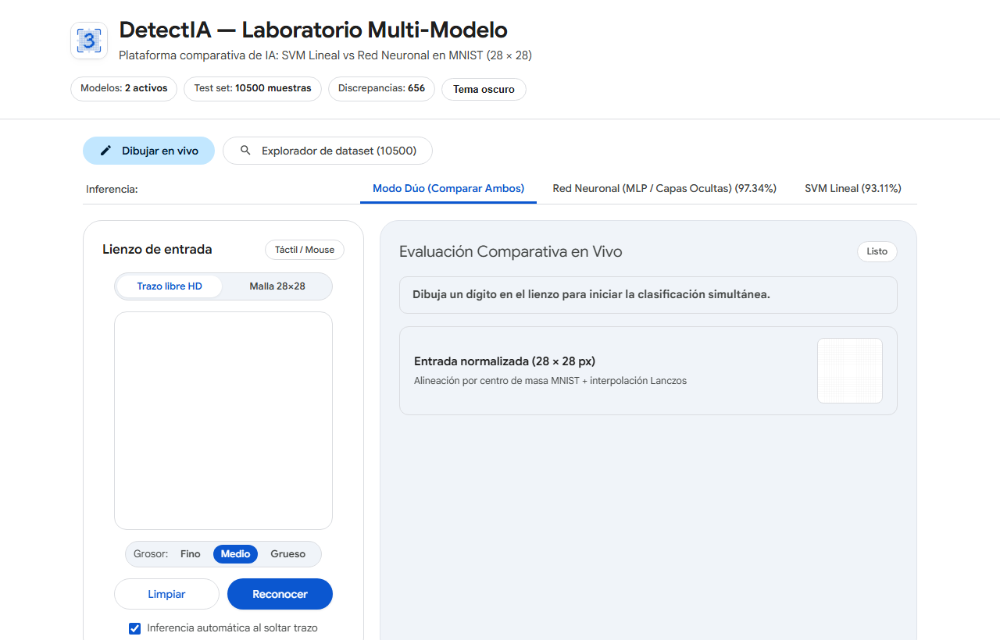
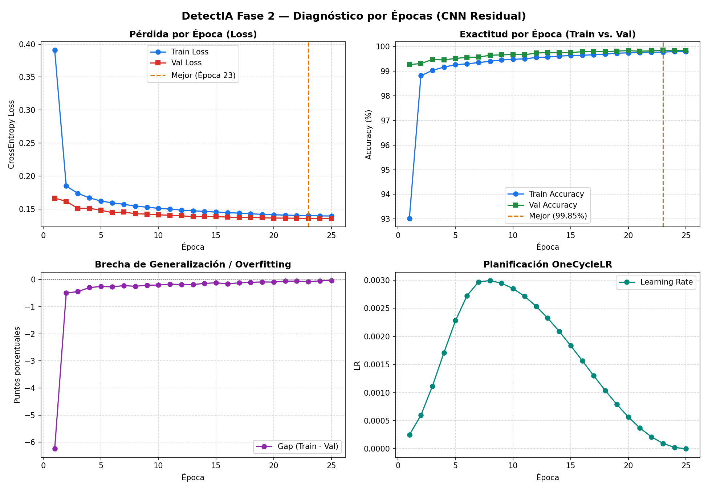
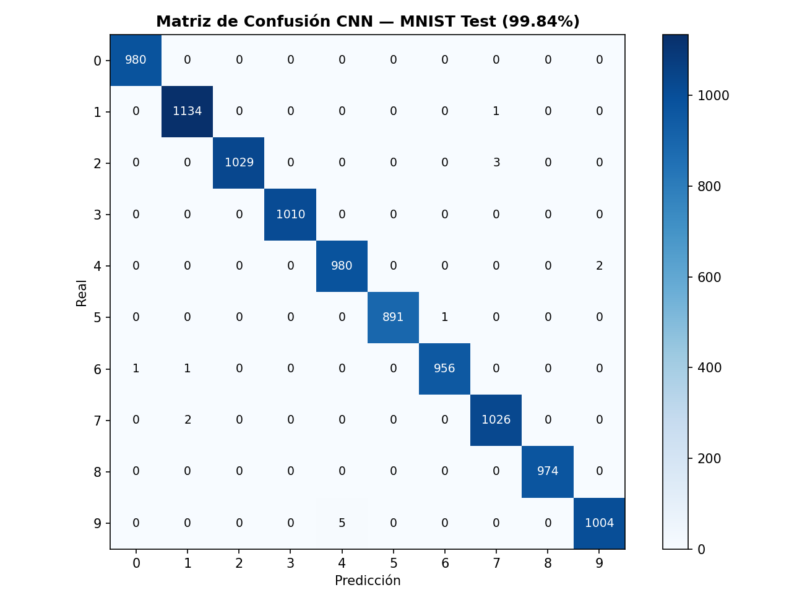
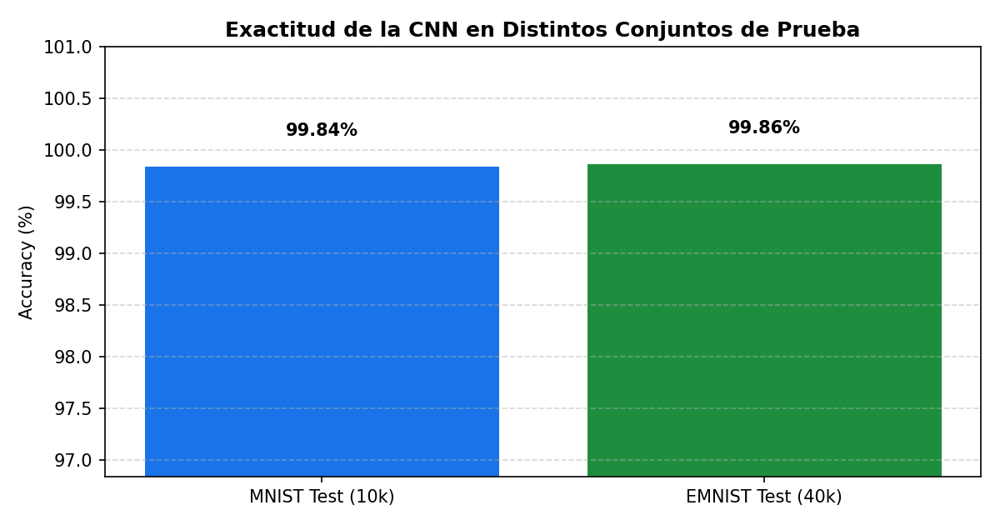
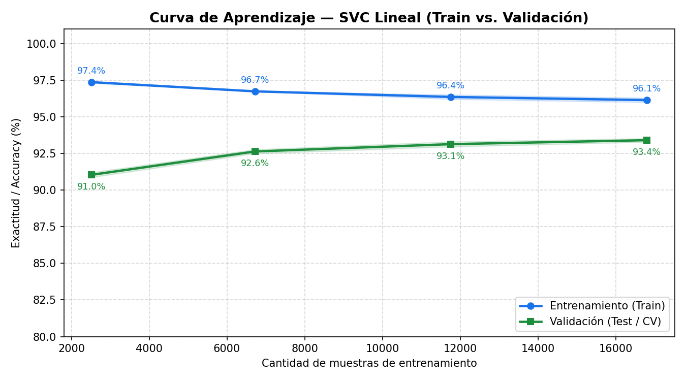
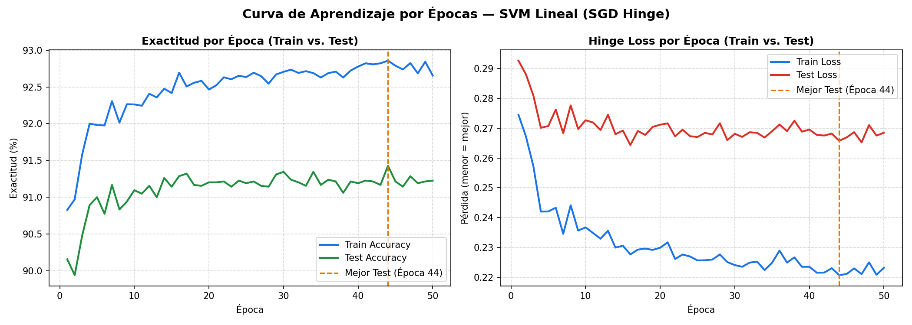
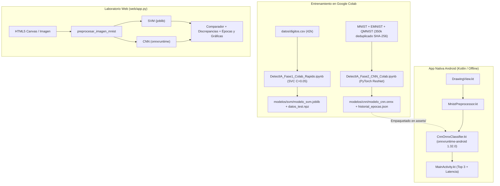

# DetectIA — Laboratorio Multi-Modelo y App Android CNN (MNIST)

> Sistema de reconocimiento de dígitos manuscritos (`0` al `9`) compuesto por un **laboratorio web comparativo** en Flask (**SVM Lineal** vs. **Red Neuronal CNN ONNX**) y una **aplicación nativa Android 100% offline** impulsada por la CNN.


## Tabla de contenidos

1. [Resumen del proyecto](#resumen-del-proyecto)
2. [Capturas y gráficas](#capturas-y-gráficas)
3. [Funcionalidades implementadas](#funcionalidades-implementadas)
4. [Arquitectura](#arquitectura)
5. [Stack tecnológico](#stack-tecnológico)
6. [Estructura del repositorio](#estructura-del-repositorio)
7. [Instalación y ejecución](#instalación-y-ejecución)
8. [Especificación de la API REST](#especificación-de-la-api-rest)
9. [Preprocesamiento matemático MNIST](#preprocesamiento-matemático-mnist)
10. [Comparativa real de modelos](#comparativa-real-de-modelos)
11. [Limitaciones y estado del proyecto](#limitaciones-y-estado-del-proyecto)
12. [Licencia y autor](#licencia-y-autor)

---

## Resumen del proyecto

Los trazos dibujados a mano alzada en pantallas táctiles o lienzos web suelen fallar cuando no coinciden en escala, grosor o centrado con el estándar MNIST. **DetectIA** aplica un pipeline determinista de normalización (aislamiento de *bounding box*, escalado proporcional a `20x20` y centrado por centro de masa en `28x28`) antes de ejecutar la inferencia.

El proyecto integra dos entornos complementarios:

1. **Laboratorio web multi-modelo ([`web/app.py`](web/app.py))**: Servidor Flask con interfaz modular (HTML, CSS y JS separados) para dibujar dígitos, subir imágenes, comparar lado a lado **SVM Lineal (`93.81%`)** contra **Red Neuronal CNN (`99.84%`)**, explorar `516` discrepancias del conjunto de prueba y revisar curvas de entrenamiento por épocas y benchmarks.
2. **Aplicación nativa Android ([`Proyecto Feria/DetectIA`](Proyecto%20Feria/DetectIA/))**: Cliente Kotlin que ejecuta la **CNN Residual (`modelo_cnn.onnx`)** de forma **100% offline** mediante `onnxruntime-android`, sin conexión a internet ni servidores externos.

---

## Capturas y gráficas

### Laboratorio web y aplicación móvil (Modo Claro y Modo Oscuro)




### Diagnóstico y curvas de entrenamiento (SVM Fase 1 y CNN Fase 2)












---

## Funcionalidades implementadas

### Plataforma web (`web/app.py` + `web/templates/index.html` + `web/static/`)
* **Dibujo libre y carga de imágenes**: Lienzo HTML5 interactivo (modo trazo HD o malla `28x28`) con inferencia automática o manual, y soporte para imágenes (`PNG`, `JPG`, `WEBP`).
* **Comparativa multi-modelo en vivo**: Selector **Comparar Todos** o ejecución individual (`svm`, `cnn`), mostrando predicción, afinidades Softmax, latencia en milisegundos y matriz `28x28` preprocesada.
* **Explorador del dataset (`0` a `8.399`)**: Consulta por índice, muestras aleatorias, salto directo a las **`516` discrepancias** entre SVM y CNN (`/api/siguiente-discrepancia`) y navegación por los errores de cada modelo (`/api/siguiente-error`).
* **Pestaña Épocas y Gráficas**: Gráficas interactivas en canvas a partir de `historial_epocas.json`, tabla comparativa de benchmarks y galería con todas las gráficas exportadas de Fase 1 y Fase 2.

### Aplicación móvil Android (`Proyecto Feria/DetectIA/`)
* **Lienzo táctil adaptable ([`DrawingView.kt`](Proyecto%20Feria/DetectIA/app/src/main/java/unu/edu/detectia/DrawingView.kt))**: Suavizado cuadrático de trazo con soporte dinámico de **Modo Claro** y **Modo Oscuro**.
* **Preprocesamiento en dispositivo ([`MnistPreprocessor.kt`](Proyecto%20Feria/DetectIA/app/src/main/java/unu/edu/detectia/MnistPreprocessor.kt))**: *Bounding box*, escalado proporcional a `20x20`, centrado por centro de masa en `28x28` y normalización `[0.0f, 1.0f]`.
* **Inferencia CNN ONNX 100% offline ([`CnnOnnxClassifier.kt`](Proyecto%20Feria/DetectIA/app/src/main/java/unu/edu/detectia/CnnOnnxClassifier.kt))**: Carga `assets/modelo_cnn.onnx` (`2.3 MB`) usando `com.microsoft.onnxruntime:onnxruntime-android:1.32.0`, evalúa el tensor `(1, 1, 28, 28)`, calcula Softmax y muestra el dígito detectado, latencia, vista `28x28` y ranking Top 3.

---

## Arquitectura

No se utiliza base de datos relacional; el conocimiento aprendido reside en los artefactos serializados (`.joblib` para SVM y `.onnx` para CNN).



---

## Stack tecnológico

| Capa | Tecnología | Versión confirmada | Responsabilidad |
| :--- | :--- | :--- | :--- |
| Lenguaje servidor y ML | Python | 3.11+ | Scripts, entrenamiento y servidor web |
| Servidor web | Flask | `>= 3.0.0` | API REST y vistas en `web/` |
| Inferencia CNN (Web) | ONNX Runtime | `>= 1.18.0` (`1.32.0` en `.venv`) | Ejecución de `modelo_cnn.onnx` |
| Modelo lineal (Web) | scikit-learn / joblib | `>= 1.5.0` / `>= 1.4.0` | Inferencia de `SVC(kernel='linear', C=0.05)` |
| Cálculo y datos | NumPy / pandas | `>= 2.0.0` / `>= 2.0.0` | Matrices y manipulación tabular |
| Imagen y gráficas | Pillow / SciPy / matplotlib | `>= 10.0.0` / `>= 1.12.0` / `>= 3.8.0` | Preprocesamiento Lanczos, centro de masa y gráficos |
| Cliente móvil | Kotlin + Android Gradle Plugin | AGP `9.5.1`, `minSdk 24`, `targetSdk 37` | App nativa Android (`arm64-v8a`) |
| Inferencia CNN (Android) | `onnxruntime-android` | `1.32.0` | Ejecución offline de `modelo_cnn.onnx` |
| UI móvil | Material Components / AppCompat / ConstraintLayout | `1.10.0` / `1.6.1` / `2.1.4` | Interfaz Material y temas claro/oscuro |

---

## Estructura del repositorio

```text
DetectIA/
├── datos/
│   └── digitos.csv                        # Dataset MNIST tabular (42.000 filas x 785 columnas)
├── desarrollo/
│   ├── analisis.md                        # Documento histórico de análisis inicial
│   └── diseno.md                          # Documento histórico de diseño inicial
├── img/                                   # Capturas web/móvil y gráficas de Fase 1 (SVM)
├── modelos/
│   ├── datos_test.npz                     # 8.400 muestras de prueba (ignorado en Git)
│   ├── discrepancias.json                 # Índices con divergencia entre CNN y SVM
│   ├── cnn/                               # Modelo CNN Residual: notebook + métricas + gráficas
│   │   ├── DetectIA_Fase2_CNN_Colab.ipynb
│   │   ├── info.json
│   │   ├── metricas_cnn.json
│   │   ├── historial_epocas.json
│   │   ├── modelo_cnn.onnx                # Binario ONNX (ignorado en Git)
│   │   └── img/                           # Gráficas de Fase 2 (épocas, matriz, benchmarks)
│   └── svm/                               # Modelo SVM Lineal: scripts + métricas
│       ├── DetectIA_Fase1_Colab_Rapido.ipynb
│       ├── digitos.py
│       ├── modeloDigitosLinear.py
│       ├── modeloDigitosRbf.py
│       ├── exportar_modelo_android.py
│       ├── info.json
│       ├── metricas_svm.json
│       └── modelo_svm.joblib              # Binario entrenado (ignorado en Git)
├── web/                                   # Plataforma web desacoplada (HTML, CSS, JS, Flask)
│   ├── static/
│   │   ├── css/style.css
│   │   ├── js/app.js
│   │   └── img/
│   ├── templates/index.html
│   └── app.py                             # Servidor Flask y API REST
├── Proyecto Feria/
│   └── DetectIA/                          # Proyecto Android Studio (Kotlin + ONNX Runtime)
│       ├── app/src/main/assets/modelo_cnn.onnx
│       └── app/src/main/java/unu/edu/detectia/
│           ├── CnnOnnxClassifier.kt
│           ├── DrawingView.kt
│           ├── MainActivity.kt
│           └── MnistPreprocessor.kt
├── contexto.md                            # Bitácora técnica e ideas futuras del proyecto
├── PROMPT_FASE2_5CNN.md                   # Especificación de referencia para Fase 2
└── requirements.txt                       # Dependencias de Python
```

---

## Instalación y ejecución

### 1. Clonar el repositorio e instalar dependencias Python

```bash
git clone https://github.com/TeVerde29/DetectIA.git
cd DetectIA
python -m venv .venv

# Windows (PowerShell):
.\.venv\Scripts\Activate.ps1
# Linux / macOS:
source .venv/bin/activate

pip install -r requirements.txt
```

> [!NOTE]
> Los binarios pesados (`*.joblib`, `*.onnx`, `*.npz`) están excluidos en `.gitignore`. En una copia recién clonada, ejecuta los notebooks de Colab ([SVM](modelos/svm/DetectIA_Fase1_Colab_Rapido.ipynb) y [CNN](modelos/cnn/DetectIA_Fase2_CNN_Colab.ipynb)) y descomprime sus artefactos en `modelos/` antes de iniciar el servidor web.

### 2. Iniciar el laboratorio web

```bash
python web/app.py
```

El servidor queda disponible en `http://127.0.0.1:5000`.

### 3. Compilar la aplicación Android (APK `arm64-v8a`)

Desde `Proyecto Feria/DetectIA` (requiere `modelo_cnn.onnx` en `app/src/main/assets/`):

```bash
cd "Proyecto Feria/DetectIA"

# Windows:
.\gradlew.bat assembleDebug testDebugUnitTest
# Linux / macOS:
./gradlew assembleDebug testDebugUnitTest
```

El APK compilado (`47.41 MB` con filtro `arm64-v8a`) se genera en `Proyecto Feria/DetectIA/app/build/outputs/apk/debug/app-debug.apk`.

---

## Especificación de la API REST

Rutas expuestas por [`web/app.py`](web/app.py):

| Método | Ruta | Descripción |
| :--- | :--- | :--- |
| `GET` | `/` | Renderiza la interfaz web (`web/templates/index.html`). |
| `GET` | `/api/modelos` | Lista los modelos registrados (`cnn`, `svm`) desde `modelos/*/info.json`. |
| `POST` | `/api/predecir-dibujo` | Recibe `imagen_base64` o `pixeles` (784) y `modelo_id` (`ambos`, `cnn`, `svm`). |
| `GET` | `/api/muestra/<int:idx>` | Evalúa una muestra del conjunto de prueba (`0` a `8.399`). |
| `GET` | `/api/aleatorio` | Retorna una muestra aleatoria del conjunto de prueba. |
| `GET` | `/api/siguiente-discrepancia` | Salta a la siguiente muestra donde `cnn` y `svm` predicen diferente (`516` casos). |
| `GET` | `/api/siguiente-error` | Retorna la siguiente muestra fallada por el modelo indicado (`?modelo=cnn` o `svm`). |
| `GET` | `/api/entrenamiento` | Devuelve historiales por época, benchmarks y galería de gráficas. |
| `GET` | `/modelos-media/<model_id>/<subpath>` | Sirve las gráficas generadas dentro de `modelos/<model_id>/img/`. |
| `GET` | `/repo-img/<filename>` | Sirve las gráficas de Fase 1 almacenadas en `img/`. |

---

## Preprocesamiento matemático MNIST

Tanto [`preprocesar_imagen_mnist`](web/app.py#L42-L85) en Python como [`MnistPreprocessor.process`](Proyecto%20Feria/DetectIA/app/src/main/java/unu/edu/detectia/MnistPreprocessor.kt#L35-L145) en Kotlin ejecutan:

1. **Detección de *Bounding Box***: Recorte de la región activa del trazo.
2. **Escalado proporcional a `20x20`**: Ajuste del lado mayor a 20 px conservando relación de aspecto.
3. **Centrado por centro de masa en `28x28`**: Cálculo baricéntrico $(c_x, c_y)$ ponderado por intensidad y traslado al centro `(13.5, 13.5)`.
4. **Normalización**: Escalado de intensidades al rango `[0.0, 1.0]`.

---

## Comparativa real de modelos

Métricas reales registradas en [`modelos/svm/metricas_svm.json`](modelos/svm/metricas_svm.json) y [`modelos/cnn/metricas_cnn.json`](modelos/cnn/metricas_cnn.json):

| Métrica / Parámetro | SVM Lineal (`SVC(kernel='linear', C=0.05)`) | Red Neuronal CNN (`DetectIACnnResNet -> ONNX`) |
| :--- | :--- | :--- |
| **Datos de entrenamiento** | `33.600` muestras (`80%` de `digitos.csv`) | `350.000` muestras (`MNIST + EMNIST + QMNIST`, deduplicadas SHA-256) |
| **Exactitud en validación / train** | `95.84%` (Train) | `99.85%` (Val, Época `#23`) |
| **Exactitud en prueba** | **`93.81%`** (`7.880 / 8.400` en `datos_test.npz`) | **`99.84%`** (`9.984 / 10.000` en MNIST Test) / **`99.86%`** (`39.944 / 40.000` en EMNIST Test) |
| **Tiempo de entrenamiento** | `95.96 s` (Colab CPU) | `3783.61 s` (25 épocas en Colab GPU) |
| **Formato en producción** | `modelo_svm.joblib` (Web) | `modelo_cnn.onnx` (`2.3 MB`, Web + Android offline) |

---

## Limitaciones y estado del proyecto

* **Arquitectura Android (`arm64-v8a`)**: El `app-debug.apk` (`47.41 MB`) está filtrado a `arm64-v8a` en [app/build.gradle.kts](Proyecto%20Feria/DetectIA/app/build.gradle.kts) (`abiFilters`) para reducir su peso; cubre teléfonos Android modernos de 64 bits (no emuladores `x86`).
* **Pruebas automatizadas**: La web fue validada mediante `app.test_client()` de Flask (`200 OK` en todas las rutas con `cnn` y `svm` activos) y Android compilado con `assembleDebug` + `testDebugUnitTest` (incluye únicamente `ExampleUnitTest.kt`).
* **Documentación histórica**: [`desarrollo/analisis.md`](desarrollo/analisis.md) y [`desarrollo/diseno.md`](desarrollo/diseno.md) corresponden al planteamiento inicial antes de la implementación actual.

---

## Licencia y autor

* **Licencia**: No se ha encontrado un archivo `LICENSE` en la raíz del repositorio.
* **Autor**: **Té Verde** (`@TeVerde29`) — [GitHub](https://github.com/TeVerde29)
