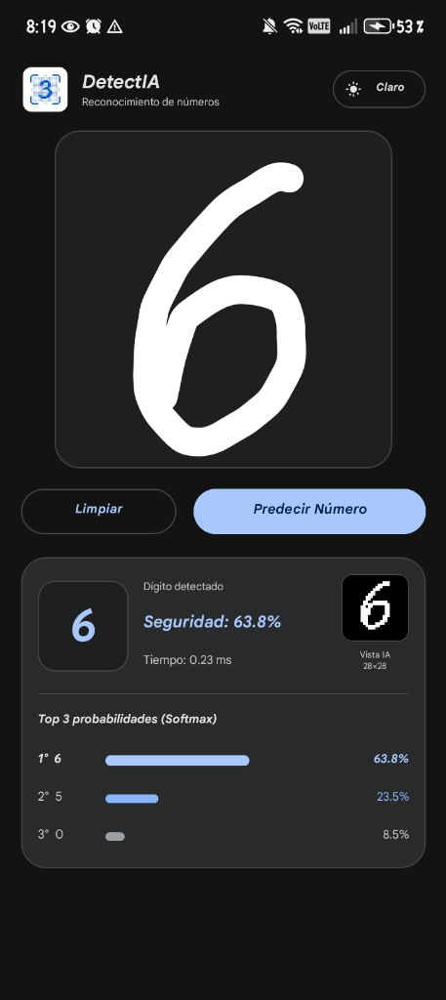
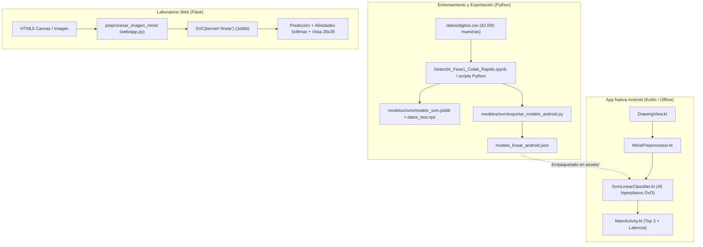

# DetectIA — Reconocimiento de Dígitos Manuscritos (Web + Android Offline)

> Sistema de aprendizaje automático para la clasificación y análisis de dígitos manuscritos del `0` al `9` (MNIST) mediante un laboratorio web en Flask y una aplicación nativa Android 100% offline basada en `SVC(kernel='linear')`.


## Tabla de contenidos

1. [Resumen del proyecto](#resumen-del-proyecto)
2. [Capturas](#capturas)
3. [Funcionalidades implementadas](#funcionalidades-implementadas)
4. [Arquitectura](#arquitectura)
5. [Stack tecnológico](#stack-tecnológico)
6. [Estructura del repositorio](#estructura-del-repositorio)
7. [Instalación y ejecución](#instalación-y-ejecución)
8. [Especificación de la API REST](#especificación-de-la-api-rest)
9. [Preprocesamiento matemático MNIST](#preprocesamiento-matemático-mnist)
10. [Motor de inferencia Android One-vs-One](#motor-de-inferencia-android-one-vs-one)
11. [Métricas del modelo actual](#métricas-del-modelo-actual)
12. [Limitaciones y estado del proyecto](#limitaciones-y-estado-del-proyecto)
13. [Licencia y autor](#licencia-y-autor)

---

## Resumen del proyecto

El reconocimiento de dígitos manuscritos dibujados libremente sobre pantallas táctiles o lienzos digitales suele fallar cuando los trazos no coinciden en escala, posición o grosor con los datos de entrenamiento. **DetectIA** resuelve este problema aplicando un pipeline de normalización geométrica estándar de MNIST (recorte de caja delimitadora, escalado proporcional a `20x20` y centrado por centro de masa en una matriz de `28x28`) antes de ejecutar la clasificación.

El proyecto está pensado para demostraciones académicas y experimentación práctica, y cuenta actualmente con dos entornos funcionales impulsados por un modelo **SVM Lineal (`SVC(kernel='linear')`)**:

1. **Laboratorio web interactivo ([`web/app.py`](web/app.py))**: Servidor Flask con interfaz inspirada en Material 3 / Google Translate para dibujar dígitos, subir imágenes, inspeccionar la matriz `28x28` procesada y explorar las `8.400` muestras del conjunto de prueba.
2. **Aplicación nativa Android ([`Proyecto Feria/DetectIA`](Proyecto%20Feria/DetectIA/))**: Cliente desarrollado en Kotlin que ejecuta inferencia matemática **100% offline** evaluando los 45 hiperplanos *One-vs-One* exportados a JSON, sin requerir conexión a internet ni runtimes externos como TensorFlow Lite u ONNX.

---

## Capturas

### Laboratorio web interactivo y matriz de confusión


### Aplicación nativa Android (Modo Claro y Modo Oscuro)




---

## Funcionalidades implementadas

### Plataforma web (`web/app.py` + `web/templates/index.html`)
* **Dibujo libre y carga de imágenes**: Lienzo HTML5 interactivo para trazar dígitos con ratón o pantalla táctil, y carga de imágenes externas (`PNG`, `JPG`, `WEBP`).
* **Visualización de entrada `28x28`**: Muestra exactamente la matriz normalizada que recibe el modelo tras el preprocesamiento.
* **Explorador del conjunto de prueba**: Permite consultar por índice (`0` a `8.399`), cargar muestras aleatorias y navegar secuencialmente por los errores del modelo (`/api/siguiente-error`).
* **Carga modular de modelos**: Descubre automáticamente subcarpetas en `modelos/` que contengan `info.json` y un binario `.joblib`. Actualmente opera con el modelo `svm` (`SVC(kernel='linear')`).

### Aplicación móvil Android (`Proyecto Feria/DetectIA/`)
* **Lienzo táctil adaptable (`DrawingView.kt`)**: Captura trazos con suavizado cuadrático y soporte dinámico de **Modo Claro** (fondo blanco, trazo negro) y **Modo Oscuro** (fondo oscuro, trazo blanco).
* **Preprocesamiento en dispositivo (`MnistPreprocessor.kt`)**: Detecta el *bounding box*, escala manteniendo proporción a `20x20`, centra por centro de masa en `28x28` y normaliza intensidades en `[0.0, 1.0]`.
* **Inferencia algebraica offline (`SvmLinearClassifier.kt`)**: Carga `modelo_linear_android.json` desde `assets/`, evalúa los 45 clasificadores binarios *One-vs-One*, muestra la predicción, el tiempo de inferencia en milisegundos, la miniatura `28x28` y el ranking Top 3 con barras de probabilidad Softmax.

---

## Arquitectura

El sistema no utiliza bases de datos relacionales; los parámetros aprendidos se almacenan directamente en archivos serializados (`.joblib` para el servidor web y `.json` de pesos para Android).



---

## Stack tecnológico

| Capa | Tecnología | Versión confirmada | Responsabilidad |
| :--- | :--- | :--- | :--- |
| Lenguaje servidor y ML | Python | 3.11+ | Entrenamiento, scripts y servidor web |
| Servidor web | Flask | `>= 3.0.0` | API REST y renderizado de `templates/index.html` |
| Machine Learning | scikit-learn | `>= 1.5.0` | Entrenamiento e inferencia con `SVC(kernel='linear')` |
| Cálculo y datos | NumPy / pandas | `>= 2.0.0` / `>= 2.0.0` | Manejo del CSV MNIST y operaciones vectoriales |
| Imagen y serialización | Pillow / SciPy / joblib | `>= 10.0.0` / `>= 1.12.0` / `>= 1.4.0` | Redimensionado Lanczos, centro de masa y carga `.joblib` |
| Graficación | matplotlib | `>= 3.8.0` | Histogramas y matriz de confusión en entrenamiento |
| Cliente móvil | Kotlin + Android Gradle Plugin | AGP `9.5.1`, `minSdk 24`, `targetSdk 37` | Aplicación nativa Android offline |
| UI móvil | Material Components / AppCompat / ConstraintLayout | `1.10.0` / `1.6.1` / `2.1.4` | Interfaz Material, fuentes y temas claro/oscuro |

---

## Estructura del repositorio

```text
DetectIA/
├── datos/
│   └── digitos.csv                        # Dataset MNIST tabular (42.000 filas x 785 columnas)
├── desarrollo/
│   ├── analisis.md                        # Documento histórico de análisis inicial (Fase 1)
│   └── diseno.md                          # Documento histórico de diseño inicial (Fase 1)
├── img/                                   # Capturas de la web, app móvil y gráficos de evaluación
├── modelos/
│   ├── datos_test.npz                     # 8.400 muestras de prueba (ignorado en Git)
│   ├── svm/                               # Modelo SVM Lineal: scripts + artefactos entrenados
│   │   ├── DetectIA_Fase1_Colab_Rapido.ipynb
│   │   ├── digitos.py
│   │   ├── modeloDigitosLinear.py
│   │   ├── modeloDigitosRbf.py
│   │   ├── exportar_modelo_android.py
│   │   ├── info.json
│   │   ├── metricas_svm.json
│   │   └── modelo_svm.joblib              # Binario entrenado (ignorado en Git)
│   └── cnn/                               # Carpeta reservada para el futuro modelo CNN
├── web/                                   # Plataforma web desacoplada (HTML, CSS, JS, Flask)
│   ├── static/
│   │   ├── css/style.css
│   │   ├── js/app.js
│   │   └── img/
│   ├── templates/index.html
│   └── app.py                             # Servidor Flask y API REST
├── Proyecto Feria/
│   └── DetectIA/                          # Proyecto Android Studio (Kotlin nativo)
│       ├── app/src/main/assets/modelo_linear_android.json
│       └── app/src/main/java/unu/edu/detectia/
│           ├── DrawingView.kt
│           ├── MainActivity.kt
│           ├── MnistPreprocessor.kt
│           └── SvmLinearClassifier.kt
├── contexto.md                            # Bitácora técnica e ideas futuras del proyecto
└── requirements.txt                       # Dependencias de Python
```

---

## Instalación y ejecución

### 1. Clonar el repositorio

```bash
git clone https://github.com/TeVerde29/DetectIA.git
cd DetectIA
```

### 2. Configurar el entorno Python y ejecutar el laboratorio web

```bash
python -m venv .venv

# Windows (PowerShell):
.venv\Scripts\Activate.ps1
# Linux / macOS:
source .venv/bin/activate

pip install -r requirements.txt
```

> [!NOTE]
> Los binarios pesados (`*.joblib`, `*.npz`) están excluidos en `.gitignore`. Antes de iniciar `web/app.py` en una copia recién clonada, asegúrate de generar los artefactos en `modelos/svm/` (`info.json`, `modelo_svm.joblib`, `metricas_svm.json`) y `modelos/datos_test.npz` (por ejemplo, ejecutando `modelos/svm/DetectIA_Fase1_Colab_Rapido.ipynb` o `modelos/svm/digitos.py`).

Inicia el servidor Flask:

```bash
python web/app.py
```

El servidor escucha en `http://127.0.0.1:5000`.

### 3. Compilar la aplicación Android

Desde el directorio del proyecto móvil:

```bash
cd "Proyecto Feria/DetectIA"

# Windows:
.\gradlew.bat assembleDebug
# Linux / macOS:
./gradlew assembleDebug
```

El APK de depuración se genera en `Proyecto Feria/DetectIA/app/build/outputs/apk/debug/app-debug.apk`.

### 4. Pruebas configuradas

* **Android**: El proyecto incluye la configuración estándar de JUnit 4 en `Proyecto Feria/DetectIA/app/src/test/java/unu/edu/detectia/ExampleUnitTest.kt` (`.\gradlew.bat test`), sin pruebas unitarias aún para el clasificador ni el preprocesador.
* **Python**: No hay una suite de pruebas automatizadas configurada en el repositorio.

---

## Especificación de la API REST

Rutas expuestas por [`web/app.py`](web/app.py):

| Método | Ruta | Descripción |
| :--- | :--- | :--- |
| `GET` | `/` | Renderiza la interfaz web (`web/templates/index.html`). |
| `GET` | `/api/modelos` | Devuelve la lista de modelos cargados desde `modelos/*/info.json`. |
| `POST` | `/api/predecir-dibujo` | Recibe `imagen_base64` o un vector `pixeles` (784 valores) y `modelo_id`, ejecuta el preprocesamiento y devuelve la predicción y puntajes Softmax. |
| `GET` | `/api/muestra/<int:idx>` | Evalúa y devuelve una muestra del conjunto de prueba (`0` a `8.399`). |
| `GET` | `/api/aleatorio` | Selecciona y evalúa una muestra aleatoria del conjunto de prueba. |
| `GET` | `/api/siguiente-error` | Devuelve la siguiente muestra fallada por el modelo indicado (`?modelo=svm&actual=-1`). |
| `GET` | `/api/siguiente-discrepancia` | Busca la siguiente muestra donde difieren dos modelos (requiere al menos 2 modelos cargados en `modelos/`). |

### Ejemplo de petición y respuesta en `POST /api/predecir-dibujo`

```json
{
  "imagen_base64": "data:image/png;base64,iVBORw0KGgoAAAANSUhEUgAA...",
  "modelo_id": "svm"
}
```

```json
{
  "modo": "svm",
  "coinciden": true,
  "pixeles_procesados": [0, 0, "... (784 enteros 0-255)"],
  "modelos": {
    "svm": {
      "id": "svm",
      "nombre": "SVM Lineal",
      "familia": "Máquina de Soporte Vectorial (SVC)",
      "prediccion": 3,
      "confianza": 75.0,
      "latencia_ms": 0.82,
      "puntajes": [0.0, 0.0, 10.0, 75.0, 0.0, 0.0, 0.0, 0.0, 10.0, 5.0]
    }
  },
  "prediccion": 3,
  "confianza": 75.0,
  "latencia_ms": 0.82,
  "puntajes": [0.0, 0.0, 10.0, 75.0, 0.0, 0.0, 0.0, 0.0, 10.0, 5.0]
}
```

---

## Preprocesamiento matemático MNIST

Tanto [`preprocesar_imagen_mnist`](web/app.py#L36-L79) en Python como [`MnistPreprocessor.process`](Proyecto%20Feria/DetectIA/app/src/main/java/unu/edu/detectia/MnistPreprocessor.kt#L35-L145) en Kotlin aplican la misma secuencia base:

1. **Aislamiento de la región activa (*Bounding Box*)**: Se localizan los límites `[x_min, y_min, x_max, y_max]` de los píxeles del trazo.
2. **Escalado proporcional a `20x20`**: El lado mayor se ajusta a 20 píxeles conservando la relación de aspecto (filtro Lanczos en Python; escalado filtrado en Android).
3. **Cálculo del centro de masa**: Se obtienen las coordenadas baricéntricas `(cx, cy)` ponderadas por intensidad `I(x, y)`:
   $$c_x = \frac{\sum x \cdot I(x, y)}{\sum I(x, y)}, \quad c_y = \frac{\sum y \cdot I(x, y)}{\sum I(x, y)}$$
4. **Centrado en `28x28` y normalización**: Se traslada el trazo para alinear su centro de masa con `(13.5, 13.5)` y se normalizan los 784 píxeles al rango `[0.0, 1.0]` dividiendo entre `255.0`.

---

## Motor de inferencia Android One-vs-One

[`SvmLinearClassifier.kt`](Proyecto%20Feria/DetectIA/app/src/main/java/unu/edu/detectia/SvmLinearClassifier.kt) reproduce la decisión multiclase *One-vs-One* de `scikit-learn` (`SVC(kernel='linear')`) para $K = 10$ clases ($45$ clasificadores binarios):

$$d_k = \mathbf{w}_k \cdot \mathbf{x} + b_k = \sum_{f=0}^{783} w_{k, f} \cdot x_f + b_k$$

* Si $d_k > 0$, suma un voto a la clase $i$; en caso contrario, suma un voto a la clase $j$, acumulando además las distancias firmadas para el desempate continuo y su conversión a porcentajes mediante Softmax.
* [`exportar_modelo_android.py`](modelos/svm/exportar_modelo_android.py) verifica que la implementación manual coincida con `modelo.predict()` antes de copiar el JSON a `app/src/main/assets/`.

---

## Métricas del modelo actual

Resultados registrados en [`modelos/svm/metricas_svm.json`](modelos/svm/metricas_svm.json) sobre la partición `80/20` estratificada (`random_state=42`, `C=0.05`, normalizado):

| Parámetro / Métrica | Valor registrado (`SVC(kernel='linear', C=0.05)`) |
| :--- | :--- |
| Muestras totales (`digitos.csv`) | 42.000 (33.600 entrenamiento / 8.400 prueba) |
| Exactitud en entrenamiento (*Train Accuracy*) | **95.84%** (`0.9583630952380953`) |
| Exactitud en prueba (*Test Accuracy*) | **93.81%** (`0.9380952380952381`) |
| Aciertos en prueba | 7.880 de 8.400 |
| Errores en prueba | 520 de 8.400 |
| Tiempo de entrenamiento | 95.96 s |
| Tiempo de predicción (batch 8.400 muestras) | 37.29 s |

---

## Limitaciones y estado del proyecto

* **Modelo único activo**: Actualmente solo está entrenado y conectado el modelo **SVM Lineal (`SVC(kernel='linear')`)**. La arquitectura de `web/app.py` ya soporta múltiples modelos en `modelos/`, pero el entrenamiento e integración de una **Red Neuronal Convolucional (CNN)** queda pendiente para una etapa posterior (documentada como idea y roadmap en [`contexto.md`](contexto.md)).
* **Artefactos fuera de Git**: Los binarios pesados (`*.joblib`, `*.npz`) y los `.apk` compilados están ignorados en Git, por lo que requieren generación local tras clonar el repositorio.
* **Diferencias menores en preprocesamiento**: `web/app.py` aplica estiramiento de contraste al máximo y desplazamiento subpíxel (`scipy.ndimage.shift`), mientras que `MnistPreprocessor.kt` usa redondeo entero de desplazamiento sobre Android `Bitmap`.
* **Documentación histórica de Fase 1**: Los archivos [`desarrollo/analisis.md`](desarrollo/analisis.md) y [`desarrollo/diseno.md`](desarrollo/diseno.md) corresponden al planteamiento inicial (PWA) antes de migrar a Flask + Android nativo.

---

## Licencia y autor

* **Licencia**: No se ha encontrado un archivo `LICENSE` en la raíz del repositorio.
* **Autor**: **Té Verde** (`@TeVerde29`) — [GitHub](https://github.com/TeVerde29)
