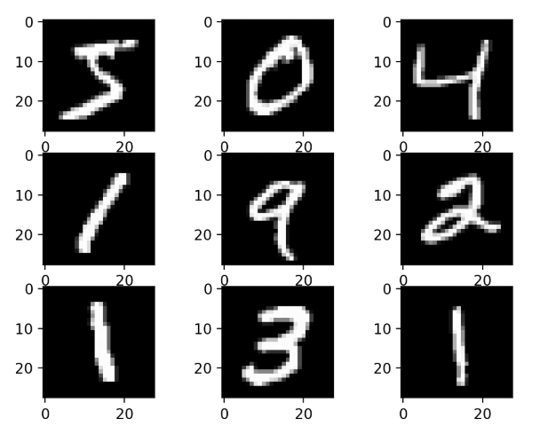
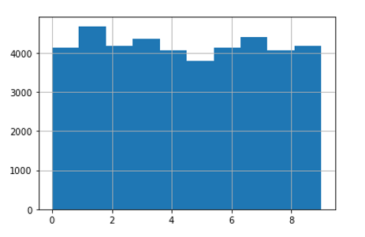

# DetectIA — Reconocimiento de Dígitos Manuscritos

> Sistema de aprendizaje automático para la clasificación y análisis de dígitos manuscritos en matrices de 28x28 píxeles a partir del dataset MNIST.


## Capturas

| Muestras del dataset MNIST | Matriz de confusión multiclase |
| :---: | :---: |
|  |  |

| Distribución de clases (0 al 9) |
| :---: |
|  |

El usuario ejecuta el flujo de entrenamiento y evaluación a través de scripts de consola; el sistema procesa 42.000 vectores de 784 píxeles, entrena un clasificador de vectores de soporte (SVM) y presenta los resultados mediante visualizaciones gráficas y matrices de error.

## Tabla de contenidos

1. [Descripción](#descripción)
2. [Repositorio](#repositorio)
3. [Características principales](#características-principales)
4. [Stack tecnológico](#stack-tecnológico)
5. [Arquitectura](#arquitectura)
6. [Estructura del dataset](#estructura-del-dataset)
7. [Instalación y uso](#instalación-y-uso)
8. [Requisitos del sistema](#requisitos-del-sistema)
9. [Flujo de ejecución y métricas](#flujo-de-ejecución-y-métricas)
10. [Autor](#autor)

---

## Descripción

El reconocimiento de caracteres manuscritos presenta variaciones significativas en grosor de trazo, inclinación, centrado y escala. DetectIA resuelve este problema aislando y normalizando muestras de dígitos individualizados en mallas de $28 \times 28$ niveles de gris para proyectar hiperplanos de separación óptimos entre 10 clases numéricas disjuntas (0 al 9).

El sistema procesa el dataset estructurado en `DATOS/digitos.csv` (42.000 filas y 785 columnas), ejecutando la separación de la variable objetivo `label` respecto a los 784 atributos de intensidad `pixel0` a `pixel783`. A través del script `digitos.py`, se entrena un modelo de máquina de soporte vectorial (`SVC`) con kernel lineal, evaluando su comportamiento sobre un conjunto de prueba desacoplado (25% del total, correspondiente a 10.500 imágenes no vistas).

A nivel de diseño de software, el sistema prescinde de bases de datos persistentes: el conocimiento matemático queda condensado en los coeficientes y vectores de soporte calculados durante el entrenamiento. Todo el ciclo de vida del proyecto está documentado formalmente bajo metodología en cascada en `analisis.md` y `diseno.md`.

## Repositorio

| Capa | Recurso | URL |
| :--- | :--- | :--- |
| Código fuente | Repositorio GitHub | https://github.com/TeVerde29/DetectIA |
| Datos | Dataset MNIST (CSV) | [`DATOS/digitos.csv`](file:///c:/Users/hikih/Documents/Repositorios/DetectIA/DATOS/digitos.csv) |
| Especificación | Análisis de requerimientos | [`analisis.md`](file:///c:/Users/hikih/Documents/Repositorios/DetectIA/analisis.md) |
| Arquitectura | Diseño del sistema | [`diseno.md`](file:///c:/Users/hikih/Documents/Repositorios/DetectIA/diseno.md) |

## Características principales

- **Clasificador SVM Lineal:** Entrenamiento mediante `sklearn.svm.SVC(kernel='linear')` optimizado para espacios de 784 dimensiones continuas.
- **Partición estratificada de datos:** División del conjunto en 31.500 muestras de entrenamiento y 10.500 de validación mediante `train_test_split(test_size=0.25)`.
- **Renderizado espacial de dígitos:** Función interna `mostrar_num` que remodela arrays unidimensionales de 784 elementos en tensores de $28 \times 28$ e invoca `plt.imshow`.
- **Validación puntual y global:** Evaluación simultánea de métricas de exactitud (`accuracy_score`), pruebas de inferencia unitarias (ejemplo de prueba individual en índice 1100) y cálculo de matriz de confusión de $10 \times 10$.
- **Inspección de balance de clases:** Histogramas y conteos de distribución (`df['label'].value_counts()`) que confirman un rango equilibrado entre ~3.795 y ~4.684 muestras por dígito.
- **Documentación de ingeniería formal:** Definición estricta de 10 Requerimientos Funcionales (RF), 6 Requerimientos No Funcionales (RNF) y 5 Reglas de Negocio (RN) bajo ciclo de vida en cascada.

## Stack tecnológico

| Capa / Componente | Tecnología | Versión | Función en el sistema |
| :--- | :--- | :--- | :--- |
| Lenguaje base | Python | 3.11.0 | Entorno de ejecución principal de scripts y pipelines |
| Aprendizaje automático | scikit-learn | 1.9.1 | Clasificación multiclase (`SVC`), métricas y partición |
| Procesamiento tabular | pandas | 3.0.5 | Carga, segmentación (`iloc`) e inspección de `digitos.csv` |
| Cálculo numérico | numpy | 2.4.6 | Conversión y reformateo de matrices ($1\text{D} \rightarrow 28\times28$) |
| Graficación científica | matplotlib | 3.11.1 | Visualización de imágenes, histogramas y mapas de calor |
| Documentación de diseño | Markdown / Mermaid | GFM | Diagramas de flujo de datos, arquitectura y secuencias |

## Arquitectura

El repositorio está organizado en módulos funcionales directos:

```text
DetectIA/
├── DATOS/
│   ├── digitos.csv             # Dataset MNIST: 42.000 filas x 785 columnas (76.7 MB)
│   └── digitos.docx            # Especificación original con capturas de código
├── img/
│   ├── muestra_digitos.png     # Visualización de la rejilla de dígitos de muestra
│   ├── histograma_distribucion.png # Frecuencia de registros por dígito
│   └── matriz_confusion.png    # Mapa de calor de aciertos y errores
├── analisis.md                 # Metodología cascada, RF, RNF y Reglas de Negocio
├── diseno.md                   # Arquitectura técnica, justificación sin BD y diagramas
├── digitos.py                  # Script ejecutable de entrenamiento y validación SVM
└── README.md                   # Documentación general del repositorio
```

### Decisiones de arquitectura

- **Persistencia sin base de datos:** El sistema no utiliza motores SQL ni NoSQL. La inferencia es determinista y sin estado (*stateless*); los parámetros aprendidos residen en los vectores de soporte del objeto `SVC`.
- **Segmentación por índices numéricos:** La separación de datos se realiza de forma fija vía `df.iloc[:, 1:785]` para el vector de características $X$ y `df.iloc[:, 0:1]` para el vector objetivo $y$.
- **Ruta de datos tolerante a contexto:** `digitos.py` detecta dinámicamente si el archivo de datos está situado en el directorio actual (`digitos.csv`) o en la carpeta secundaria (`DATOS/digitos.csv`).

## Estructura del dataset

El archivo `DATOS/digitos.csv` contiene imágenes digitalizadas en escala de grises de 8 bits por canal (valores entre 0 y 255):

```csv
label,pixel0,pixel1,pixel2,...,pixel782,pixel783
1,0,0,0,...,0,0
0,0,0,0,...,0,0
1,0,0,0,...,0,0
4,0,0,0,...,0,0
0,0,0,0,...,0,0
```

- `label`: Entero del 0 al 9 que representa la clase real del dígito.
- `pixel0` a `pixel783`: Nivel de intensidad lumínica de cada una de las celdas de la cuadrícula de $28 \times 28$ ($28 \times 28 = 784$). El valor 0 denota fondo blanco/negro inactivo y 255 denota máxima intensidad de trazo.

## Instalación y uso

### 1. Clonar el repositorio

```bash
git clone https://github.com/TeVerde29/DetectIA.git
cd DetectIA
```

### 2. Verificar o instalar dependencias

```bash
pip install pandas numpy matplotlib scikit-learn
```

### 3. Ejecución del pipeline

Ejecuta el script principal desde la raíz del proyecto:

```bash
python digitos.py
```

### Flujo secuencial de ejecución

1. **Carga e inspección:** El sistema lee `DATOS/digitos.csv`, imprime `df.info()`, las primeras 5 filas y la distribución de clases.
2. **Generación de histograma:** Se abre la ventana gráfica de distribución; ciérrala para continuar el flujo.
3. **Muestra visual:** Se grafica una muestra individual de prueba (`X_test.iloc[3]`) reconstruida en $28 \times 28$.
4. **Entrenamiento:** Inicia `modelo.fit(X_train.values, y_train.values.ravel())`. La consola imprime el tiempo transcurrido (aproximadamente 50 a 60 segundos según CPU).
5. **Reporte de exactitud:** Se generan predicciones sobre 10.500 muestras y se imprime la precisión global (aproximadamente `0.9697` o 97%).
6. **Prueba unitaria:** Se procesa el registro 1100, comparando el valor esperado contra el predicho por la máquina.
7. **Matriz de confusión:** Se calcula la matriz $10 \times 10$ y se despliega el mapa de calor con el recuento exacto de predicciones correctas e incorrectas.

## Requisitos del sistema

| Componente | Requisito mínimo | Requisito recomendado |
| :--- | :--- | :--- |
| Sistema Operativo | Windows 10 / Ubuntu 20.04 / macOS 12 | Windows 11 / Linux x86_64 |
| Procesador (CPU) | Doble núcleo 2.0 GHz | Cuatro núcleos 3.0 GHz o superior |
| Memoria RAM | 4 GB | 8 GB o superior |
| Espacio en disco | 500 MB libres (dataset: ~77 MB) | 1 GB libre |
| Intérprete | Python 3.10+ | Python 3.11+ |

## Flujo de ejecución y métricas

```text
Cargando dataset desde: DATOS/digitos.csv ...
RangeIndex: 42000 entries, 0 to 41999
Columns: 785 entries, label to pixel783
dtypes: int64(785)
memory usage: 251.5 MB

Dimensiones de entrenamiento: (31500, 784)
Dimensiones de prueba:        (10500, 784)

Iniciando entrenamiento del modelo SVM (kernel='linear') ...
Entrenamiento terminado en ~59.56 segundos
Predicción terminada en ~97.29 segundos
Precisión alcanzada: 0.96976 (96.98%)
```

---

**Té Verde** (`@TeVerde29`)  
GitHub: [https://github.com/TeVerde29](https://github.com/TeVerde29)  
Contacto: hikih020@gmail.com

---

Si este proyecto te resultó útil, considera darle una estrella en GitHub.
