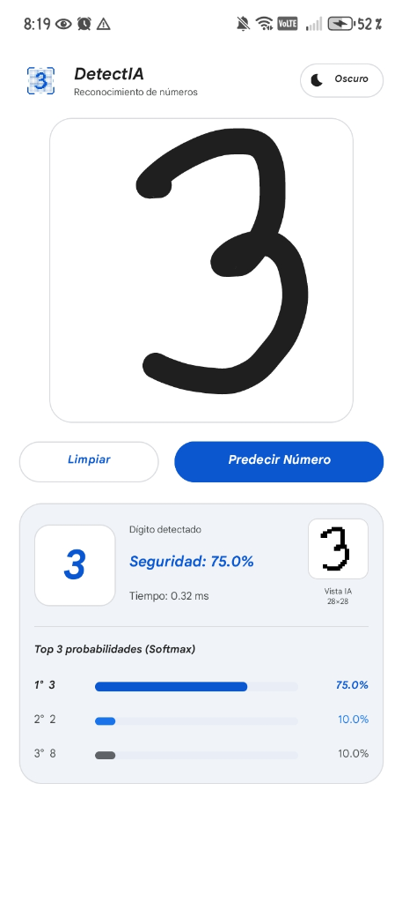

# DetectIA — Laboratorio Multi-Modelo y Plataforma Móvil de Reconocimiento de Dígitos

> Sistema integral de aprendizaje automático para la clasificación, comparación y análisis de dígitos manuscritos (MNIST) mediante interfaz web estilo Google Translate y aplicación nativa Android 100% offline.


## Capturas

| Laboratorio web interactivo (diseño Google Translate) | Matriz de confusión multiclase SVM |
| :---: | :---: |
|  |  |

| App Android nativa offline (Modo Claro) | App Android nativa offline (Modo Oscuro) |
| :---: | :---: |
|  |  |

Los investigadores y estudiantes exploran el laboratorio web para contrastar la exactitud y los vectores de probabilidad entre Máquinas de Soporte Vectorial (SVM) y Redes Neuronales Artificiales (MLP) sobre casos límite de MNIST, mientras que los usuarios móviles dibujan trazos sobre la pantalla táctil de su dispositivo Android para obtener inferencias instantáneas en 0.23 ms sin conexión a internet ni servidores externos.

## Tabla de contenidos

1. [Descripción](#descripción)
2. [Demo / Producción / Descarga](#demo--producción--descarga)
3. [Características principales](#características-principales)
4. [Stack tecnológico](#stack-tecnológico)
5. [Arquitectura](#arquitectura)
6. [Instalación y uso](#instalación-y-uso)
7. [Requisitos del sistema](#requisitos-del-sistema)
8. [Especificación de la API REST](#especificación-de-la-api-rest)
9. [Preprocesamiento matemático MNIST](#preprocesamiento-matemático-mnist)
10. [Motor de inferencia Android One-vs-One](#motor-de-inferencia-android-one-vs-one)
11. [Comparativa de modelos](#comparativa-de-modelos)
12. [Licencia](#licencia)
13. [Autor](#autor)

---

## Descripción

El reconocimiento de dígitos manuscritos presenta problemas complejos debido a la heterogeneidad caligráfica: variaciones de escala, grosor de trazo, excentricidad y desalineación espacial respecto a la cuadrícula de captura. DetectIA aborda este desafío mediante una solución desacoplada que normaliza trazos libres hacia una cuadrícula estándar de $28 \times 28$ píxeles y ejecuta clasificación multiclase sobre 10 categorías numéricas (del 0 al 9).

El proyecto integra dos entornos operativos complementarios. Por un lado, una plataforma web construida en Flask con estética minimalista basada en Google Translate, que admite dibujo libre y carga de imágenes, facilitando la comparación lado a lado entre clasificadores de margen lineal (SVM) y arquitecturas densas no lineales (Redes Neuronales Perceptrón Multicapa). Por otro lado, una aplicación nativa Android desarrollada en Kotlin que traslada el modelo SVM a la arquitectura del cliente móvil, ejecutando inferencia 100% offline con tiempos de respuesta inferiores a un milisegundo.

A nivel de diseño de ingeniería, el sistema descarta bases de datos persistentes: el conocimiento matemático del clasificador reside en los parámetros vectoriales y sesgos serializados. El pipeline de procesamiento asegura paridad estricta entre cliente y servidor mediante centrado por centro de masa subpíxel y redimensionamiento proporcional Lanczos, garantizando que los trazos dibujados a mano emulen con fidelidad la distribución del dataset MNIST.

## Demo / Producción / Descarga

| Capa / Recurso | Detalle | Enlace |
| :--- | :--- | :--- |
| Código fuente | Repositorio oficial en GitHub | [https://github.com/TeVerde29/DetectIA](https://github.com/TeVerde29/DetectIA) |
| Aplicación móvil | APK instalable Android (Debug) | [`Proyecto Feria/DetectIA/app/build/outputs/apk/debug/app-debug.apk`](file:///c:/Users/hikih/Documents/Repositorios/DetectIA/Proyecto%20Feria/DetectIA/app/build/outputs/apk/debug/app-debug.apk) |
| Datos de entrenamiento | Dataset tabular MNIST (42.000 muestras) | [`DATOS/digitos.csv`](file:///c:/Users/hikih/Documents/Repositorios/DetectIA/DATOS/digitos.csv) |
| Especificación formal | Requerimientos bajo ciclo cascada | [`desarrollo/analisis.md`](file:///c:/Users/hikih/Documents/Repositorios/DetectIA/desarrollo/analisis.md) |
| Documento de diseño | Arquitectura técnica y diagramas | [`desarrollo/diseno.md`](file:///c:/Users/hikih/Documents/Repositorios/DetectIA/desarrollo/diseno.md) |

## Características principales

- **Arquitectura multi-modelo desacoplada:** Estructura de directorios modular en `modelos/` que permite registrar modelos independientes (SVM Lineal y Red Neuronal MLP) con metadatos de configuración en `info.json`.
- **Laboratorio web con estética Google Translate:** Panel interactivo en Flask con lienzo HTML5, barra de navegación superior, cambio de vistas (dibujo o archivo) y visualización simultánea de dos modelos.
- **Preprocesamiento matemático estricto:** Aislamiento de la caja delimitadora (*bounding box*), escalado proporcional Lanczos a una malla de $20 \times 20$ y reubicación subpíxel por centro de masa a la coordenada $(13.5, 13.5)$.
- **Inferencia Android nativa 100% offline:** Motor algebraico en Kotlin puro (`SvmLinearClassifier.kt`) que evalúa 45 hiperplanos One-vs-One sin requerir TensorFlow Lite ni dependencias externas pesadas.
- **Rendimiento de ultra-baja latencia:** Tiempos de ejecución en dispositivo móvil de 0.20 ms a 0.35 ms por predicción sobre procesadores ARM comerciales.
- **Soporte nativo de temas Claro y Oscuro:** Adaptabilidad visual completa en la aplicación móvil con conmutación dinámica de paletas cromáticas de alto contraste.
- **Explorador de discrepancias empíricas:** Mecanismo en servidor para extraer de forma automática muestras del conjunto de prueba donde el clasificador lineal y la red neuronal emiten predicciones divergentes.

## Stack tecnológico

| Capa / Componente | Tecnología | Versión | Función en el sistema |
| :--- | :--- | :--- | :--- |
| Lenguaje servidor | Python | 3.11.0 | Entorno de backend, pipelines y cálculo científico |
| Framework web | Flask | >= 3.0.0 | API REST y servidor de la interfaz web |
| Aprendizaje automático | scikit-learn | >= 1.5.0 | Algoritmos `LinearSVC` y `MLPClassifier` |
| Cálculo matricial | NumPy | >= 2.0.0 | Operaciones tensoriales y normalización vectorial |
| Manipulación de datos | pandas | >= 2.0.0 | Carga y segmentación de datos tabulares MNIST |
| Procesamiento de imagen | Pillow / SciPy | >= 10.0 / >= 1.12 | Interpolación Lanczos y cálculo de centro de masa |
| Lenguaje móvil | Kotlin | 1.9.0 | Lógica nativa de la aplicación Android |
| Plataforma móvil | Android SDK | SDK 35 (compile 37) | Sistema operativo de la aplicación de usuario final |
| Interfaz móvil | Material Components | 1.10.0 | Componentes UI, tipografía Google Sans y estilos |
| Serialización móvil | JSON | RFC 8259 | Almacenamiento empaquetado de pesos ($W, b$) en assets |

## Arquitectura

```text
DetectIA/
├── DATOS/
│   └── digitos.csv                         # Dataset MNIST: 42.000 filas x 785 columnas
├── desarrollo/
│   ├── analisis.md                         # Requerimientos funcionales y reglas de negocio
│   └── diseno.md                           # Diagramas de flujo y arquitectura técnica
├── img/
│   ├── app_modo_claro.png                  # Captura de pantalla Android en tema claro
│   ├── app_modo_oscuro.png                 # Captura de pantalla Android en tema oscuro
│   ├── web_laboratorio.png                 # Captura de la interfaz web multi-modelo
│   ├── matriz_confusion.png                # Mapa de calor de evaluación multiclase
│   ├── muestra_digitos.png                 # Muestra de caracteres del dataset
│   └── histograma_distribucion.png         # Balance de frecuencias por clase numérica
├── modelos/
│   ├── cnn/
│   │   ├── info.json                       # Configuración y metadatos de la Red Neuronal
│   │   ├── metricas_cnn.json               # Métricas de prueba y exactitud (97.34%)
│   │   └── modelo_cnn.joblib               # Binario entrenado de MLPClassifier
│   ├── svm/
│   │   ├── info.json                       # Configuración y metadatos del modelo SVM
│   │   ├── metricas_svm.json               # Métricas de prueba y exactitud (93.11%)
│   │   └── modelo_svm.joblib               # Binario entrenado de LinearSVC
│   ├── datos_test.npz                      # 10.500 vectores de prueba desacoplados
│   └── discrepancias.json                  # Índices de validación con divergencia de modelos
├── Proyecto Feria/DetectIA/                # Proyecto Android Studio (Kotlin nativo)
│   ├── app/
│   │   ├── src/main/assets/
│   │   │   └── modelo_linear_android.json  # Pesos (45x784) y sesgos embebidos (268 KB)
│   │   ├── src/main/java/unu/edu/detectia/
│   │   │   ├── DrawingView.kt              # Lienzo táctil con interpolación de trazo
│   │   │   ├── MainActivity.kt             # Ciclo de vida UI y alternancia claro/oscuro
│   │   │   ├── MnistPreprocessor.kt        # Bounding box, Lanczos y centrado por masa
│   │   │   └── SvmLinearClassifier.kt      # Motor de inferencia One-vs-One y Softmax
│   │   └── src/main/res/                   # Layouts, fuentes Google Sans y temas día/noche
│   └── build.gradle.kts                    # Configuración de compilación Android
├── static/
│   └── img/                                # Recursos gráficos y logos de la web
├── templates/
│   └── index.html                          # Interfaz web responsiva con canvas interactivo
├── app.py                                  # Servidor Flask y controlador de inferencia REST
├── digitos.py                              # Pipeline clásico de validación y graficación
└── requirements.txt                        # Especificación estricta de dependencias Python
```

### Decisiones de arquitectura

- **Persistencia en coeficientes algebraicos:** No existen bases de datos relacionales ni motores SQL. El aprendizaje se traduce directamente a hiperplanos de corte definidos por matrices de pesos y vectores de sesgo.
- **Preprocesamiento desacoplado pero idéntico:** Tanto `app.py` en Python como `MnistPreprocessor.kt` en Android replican las mismas fases matemáticas: extracción de caja delimitadora, escalado a $20 \times 20$, centrado por centro de masa sobre matriz de $28 \times 28$ y normalización de intensidad en rango $[0, 1]$.
- **Inferencia perimetral (Edge Computing):** La aplicación móvil no realiza peticiones HTTP para predecir. El clasificador reside en el paquete APK en formato JSON optimizado, asegurando privacidad total y funcionamiento autónomo sin cobertura de red.
- **Modularidad extensible:** El directorio `modelos/` permite incorporar nuevos modelos de clasificación sin modificar el código del servidor; basta con crear una subcarpeta con su `info.json` y archivo `.joblib`.

## Instalación y uso

### 1. Clonar el repositorio

```bash
git clone https://github.com/TeVerde29/DetectIA.git
cd DetectIA
```

### 2. Configurar el entorno de Python

```bash
python -m venv .venv
# En Windows (PowerShell):
.venv\Scripts\Activate.ps1
# En Linux / macOS:
source .venv/bin/activate

pip install -r requirements.txt
```

### 3. Iniciar el laboratorio web

```bash
python app.py
```

El servidor quedará a la escucha en `http://127.0.0.1:5000`.

### 4. Compilar la aplicación Android

Desde el directorio del proyecto móvil:

```bash
cd "Proyecto Feria/DetectIA"
# En Windows:
.\gradlew.bat assembleDebug
# En Linux / macOS:
./gradlew assembleDebug
```

El archivo APK generado se ubicará en:
`Proyecto Feria/DetectIA/app/build/outputs/apk/debug/app-debug.apk`

### Flujo básico de uso

1. **Selección de modalidad:** Abrir la aplicación móvil o ingresar al laboratorio web en el navegador.
2. **Dibujo de trazo:** Dibujar con el ratón o con el dedo un dígito del 0 al 9 en el lienzo central.
3. **Ejecución de inferencia:** Pulsar sobre el botón principal **"Predecir Número"**.
4. **Análisis de resultados:** Observar la miniatura procesada de $28 \times 28$, la clase predicha con mayor probabilidad y el desglose de afinidad Softmax.
5. **Modo comparativo (Web):** Seleccionar la opción de dos modelos simultáneos para contrastar la hipótesis de corte del modelo lineal frente a la red neuronal.

## Requisitos del sistema

| Componente | Requisito mínimo | Requisito recomendado |
| :--- | :--- | :--- |
| Sistema Operativo (Servidor) | Windows 10 / Ubuntu 20.04 / macOS 12 | Windows 11 / Linux x86_64 |
| Dispositivo Móvil (Cliente) | Android 7.0 (API 24 - Nougat) | Android 11.0 o superior (API 30+) |
| Memoria RAM (Servidor) | 4 GB | 8 GB |
| Memoria RAM (Dispositivo móvil) | 2 GB | 4 GB |
| Procesador (CPU Servidor) | Dual-core 2.0 GHz | Quad-core 3.0 GHz |
| Espacio en disco | 600 MB libres | 1.5 GB libres |
| Entorno de ejecución | Python 3.11+ / Java JDK 17+ | Python 3.11 / JDK 17 / Android Studio |

## Especificación de la API REST

El servidor `app.py` expone las siguientes rutas de servicio:

```text
GET  /                          Renderiza la interfaz gráfica interactiva.
GET  /api/modelos               Lista los modelos registrados y sus metadatos de exactitud.
POST /api/predecir-dibujo       Recibe una imagen en Base64 o array de 784 px y devuelve la predicción.
GET  /api/muestra/<int:idx>     Recupera un vector del conjunto de test por índice (0 a 10.499).
GET  /api/aleatorio             Retorna una muestra aleatoria del conjunto de prueba.
GET  /api/siguiente-discrepancia Devuelve la siguiente muestra donde SVM y Red Neuronal difieren.
GET  /api/siguiente-error       Retorna la siguiente muestra fallada por el modelo especificado.
```

### Ejemplo de petición y respuesta en `/api/predecir-dibujo`

**Petición (JSON):**
```json
{
  "imagen_base64": "data:image/png;base64,iVBORw0KGgoAAAANSUhEUgAA...",
  "modelo_id": "ambos"
}
```

**Respuesta (JSON):**
```json
{
  "modo": "ambos",
  "coinciden": true,
  "prediccion": 3,
  "confianza": 75.0,
  "latencia_ms": 1.25,
  "modelos": {
    "svm": {
      "nombre": "SVM Lineal",
      "prediccion": 3,
      "confianza": 75.0,
      "latencia_ms": 0.82,
      "puntajes": [0.0, 0.0, 10.0, 75.0, 0.0, 0.0, 0.0, 0.0, 10.0, 5.0]
    },
    "cnn": {
      "nombre": "Red Neuronal MLP",
      "prediccion": 3,
      "confianza": 94.2,
      "latencia_ms": 0.43,
      "puntajes": [0.1, 0.0, 0.5, 94.2, 0.0, 2.1, 0.0, 0.1, 2.5, 0.5]
    }
  }
}
```

## Preprocesamiento matemático MNIST

Para que la clasificación sea robusta ante dibujos realizados en lienzos de alta resolución, la imagen se somete al siguiente pipeline:

1. **Aislamiento de la región activa:** Se calcula la caja delimitadora $[x_{\min}, y_{\min}, x_{\max}, y_{\max}]$ descartando los píxeles de fondo.
2. **Escalado con conservación de relación de aspecto:** La dimensión mayor de la caja se redimensiona a 20 píxeles usando interpolación Lanczos, ajustando proporcionalmente la otra dimensión:
   $$\text{escala} = \frac{20}{\max(w, h)}$$
3. **Cálculo del centro de masa:** Sobre el lienzo de $28 \times 28$, se obtienen las coordenadas baricéntricas ponderadas por la intensidad de cada píxel $I(x, y)$:
   $$c_x = \frac{\sum x \cdot I(x, y)}{\sum I(x, y)}, \quad c_y = \frac{\sum y \cdot I(x, y)}{\sum I(x, y)}$$
4. **Desplazamiento subpíxel:** La matriz se traslada para alinear su centro de masa con el centro geométrico oficial de MNIST en $(13.5, 13.5)$:
   $$\Delta x = 13.5 - c_x, \quad \Delta y = 13.5 - c_y$$

## Motor de inferencia Android One-vs-One

El clasificador móvil no requiere librerías externas ni intérpretes de red neuronal. Ejecuta la formulación algebraica multiclase de *Support Vector Classifier* bajo la estrategia One-vs-One (OvO):

Para $K = 10$ clases, se evalúan $N = \frac{K(K - 1)}{2} = 45$ hiperplanos binarios independientes. Cada clasificador $k$ entre la clase $i$ y la clase $j$ calcula el producto escalar:

$$d_k = \mathbf{w}_k \cdot \mathbf{x} + b_k = \sum_{f=0}^{783} w_{k, f} \cdot x_f + b_k$$

- Si $d_k > 0$, se suma un voto a la clase $i$ y se acumula $d_k$ en su confianza continua.
- Si $d_k \le 0$, se suma un voto a la clase $j$ y se resta $d_k$ en su confianza continua.

La clase final predicha corresponde a aquella con mayor número de votos acumulados. Posteriormente, las puntuaciones continuas normalizadas se transforman en porcentajes mediante la función Softmax:

$$P(\text{clase } c) = \frac{e^{\sigma \cdot s_c}}{\sum_{m=0}^{9} e^{\sigma \cdot s_m}} \times 100\%$$

## Comparativa de modelos

Evaluación realizada sobre el conjunto de prueba independiente de 10.500 imágenes (`modelos/datos_test.npz`):

| Métrica / Parámetro | SVM Lineal (`LinearSVC`) | Red Neuronal Artificial (`MLPClassifier`) |
| :--- | :--- | :--- |
| Exactitud global (*Accuracy*) | **93.11%** | **97.34%** |
| Aciertos en test | 9.777 de 10.500 | 10.221 de 10.500 |
| Errores en test | 723 de 10.500 | 279 de 10.500 |
| Tiempo de entrenamiento | 76.47 segundos | 29.61 segundos |
| Tiempo de inferencia (Web batch) | 28.23 segundos (2.6 ms/muestra) | 0.03 segundos (0.003 ms/muestra) |
| Latencia móvil unitaria (Android) | **0.23 ms - 0.32 ms** | N/A (Solo servidor) |
| Peso del modelo exportado | 268 KB (JSON de coeficientes) | 3.2 MB (Joblib) |
| Dependencia de ejecución | Kotlin puro / Sin librerías | scikit-learn / Servidor |

## Licencia

Este proyecto se distribuye bajo la licencia **MIT**.

---

**Té Verde** (@TeVerde29)  
GitHub: [https://github.com/TeVerde29](https://github.com/TeVerde29)  
Contacto: hikih020@gmail.com

---

Si este proyecto te resultó útil, considera darle una estrella en GitHub.
