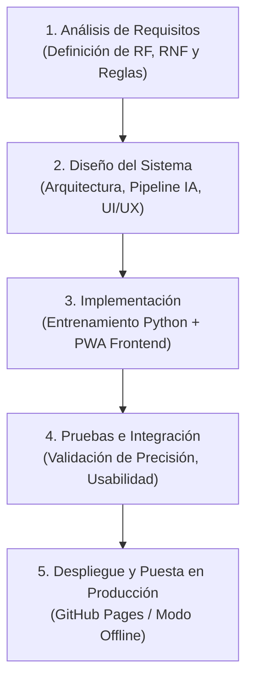

# Documento de Análisis de Requerimientos - DetectIA

## 1. Introducción y Alcance del Proyecto

**DetectIA** es una aplicación móvil web progresiva (PWA) e interactiva, diseñada para el aniversario universitario, cuyo propósito es demostrar de forma práctica y visual el funcionamiento de la Inteligencia Artificial (Visión por Computadora y Reconocimiento de Patrones). 

El sistema permite a cualquier usuario dibujar un dígito numérico (del 0 al 9) con su dedo o lápiz óptico en una pantalla táctil, ver en tiempo real cómo ese trazo libre se convierte en una matriz digitalizada de **28x28 píxeles**, y obtener al instante la clasificación del número mediante un modelo de **Red Neuronal Convolucional (CNN)** previamente entrenado en Python con el dataset MNIST (`digitos.csv`).

El sistema está concebido para operar de forma **100% autónoma y offline** (sin depender de internet ni de servidores externos durante la exhibición), garantizando cero fallos de conectividad en el evento.

---

## 2. Metodología de Desarrollo: Modelo en Cascada (Waterfall)

Para este proyecto se adopta la metodología tradicional de **Modelo en Cascada**, caracterizada por una secuencia lineal y ordenada de fases donde cada etapa debe completarse y validarse antes de pasar a la siguiente.

### Justificación de la Metodología
1. **Alcance y Requisitos Claramente Delimitados**: El objetivo, los datos de entrada (dataset MNIST de 42.000 muestras) y las especificaciones técnicas (matriz de 28x28, predicción 0-9, soporte móvil táctil) están perfectamente definidos desde el inicio.
2. **Fecha de Entrega Inamovible**: Al tratarse de un proyecto para el aniversario de la universidad, el cronograma es estricto y no admite desviaciones de alcance sobre la marcha.
3. **Dependencia Técnica Secuencial Estricta**: No se puede construir el motor de inferencia del cliente ni la visualización de la cuadrícula sin haber entrenado, validado y exportado previamente el modelo de IA en Python.
4. **Documentación Académica Rigurosa**: Facilita la generación de informes técnicos formales para la evaluación de la cátedra universitaria.

---

## 3. Requerimientos Funcionales (RF)

| Código | Nombre | Descripción | Prioridad |
| :--- | :--- | :--- | :--- |
| **RF-01** | **Ingesta y Preparación de Datos** | El sistema en Python debe cargar el dataset [`DATOS/digitos.csv`](file:///c:/Users/hikih/Documents/Repositorios/DetectIA/DATOS/digitos.csv) (42.000 filas y 785 columnas), normalizar los valores de los píxeles [0, 255] a [0.0, 1.0] y dividir el conjunto en entrenamiento y validación. | Alta |
| **RF-02** | **Entrenamiento y Exportación de la IA** | El script de Python debe entrenar una arquitectura de Red Neuronal Convolucional (CNN) y exportar los pesos/grafo del modelo a un formato estándar liviano (`.onnx` / `.json` / `.tflite`). | Alta |
| **RF-03** | **Lienzo Táctil de Dibujo Libre** | La aplicación móvil debe proveer una superficie de dibujo (HTML5 Canvas) optimizada para eventos táctiles (`touchstart`, `touchmove`, `touchend`) con trazo suave y fluido. | Alta |
| **RF-04** | **Preprocesamiento MNIST en Tiempo Real** | El sistema debe tomar el trazo dibujado, calcular su caja delimitadora (bounding box), escalarlo proporcionalmente a una caja de $20 \times 20$ y centrarlo por **centro de masa** dentro de un lienzo de $28 \times 28$ píxeles, replicando el estándar MNIST. | Alta |
| **RF-05** | **Visualización de Cuadrícula 28x28** | La interfaz debe renderizar en pantalla una cuadrícula visible de $28 \times 28$ celdas donde el usuario pueda observar exactamente cómo la IA "ve" los píxeles de su dibujo. | Alta |
| **RF-06** | **Inferencia Inmediata del Dígito** | El motor de inferencia debe procesar el vector de 784 píxeles y determinar el dígito predicho (0 al 9) con el valor de máxima probabilidad (función Softmax). | Alta |
| **RF-07** | **Distribución de Probabilidades** | La aplicación debe desplegar un gráfico de barras interactivo con los porcentajes de certeza para cada uno de los 10 dígitos posibles (0 al 9). | Media |
| **RF-08** | **Controles de Lienzo** | La aplicación debe ofrecer botones de acción clara: "Limpiar Lienzo", "Reconocer", y selector o ajuste de grosor de trazo. | Alta |
| **RF-09** | **Operabilidad 100% Offline (PWA)** | La aplicación debe registrar un Service Worker que almacene en caché todos los activos (HTML, CSS, JS y el archivo del modelo de IA), permitiendo ejecutar la app en modo avión sin conexión a internet. | Alta |
| **RF-10** | **API de Inferencia Alternativa (Backend Python)** | El proyecto debe incluir opcionalmente un servidor en Python (Flask) con el endpoint `POST /api/predict` para demostración ante docentes que requieran evaluar la ejecución en servidor. | Media |

---

## 4. Requerimientos No Funcionales (RNF)

| Código | Categoría | Requisito | Criterio de Aceptación |
| :--- | :--- | :--- | :--- |
| **RNF-01** | **Rendimiento** | Latencia de Inferencia | El tiempo de cálculo desde que se termina el trazo hasta que se presenta la predicción no debe superar los **100 milisegundos** en un smartphone de gama media. |
| **RNF-02** | **Precisión** | Exactitud del Modelo (Accuracy) | El modelo entrenado debe alcanzar una precisión mínima del **98.0%** en el conjunto de prueba para reducir falsos positivos en dibujos imperfectos. |
| **RNF-03** | **Disponibilidad** | Cero Dependencia de Red | El 100% de las funciones principales (dibujo, preprocesamiento, inferencia y visualización) deben operar sin conexión a internet. |
| **RNF-04** | **Usabilidad** | Ergonomía Mobile-First | La interfaz debe adaptarse a cualquier tamaño de pantalla móvil, con zonas táctiles amplias (mínimo 48x48 px por botón) para uso con el pulgar. |
| **RNF-05** | **Portabilidad** | Compatibilidad Multiplataforma | La aplicación debe funcionar sin modificaciones en navegadores móviles modernos (Google Chrome, Safari, Edge, Firefox) y ser convertible a `.apk` de Android mediante Capacitor. |
| **RNF-06** | **Eficiencia** | Peso Ligero del Bundle | El tamaño total del aplicativo web junto con el archivo del modelo de IA no debe exceder los **3.5 MB**, permitiendo carga instantánea. |

---

## 5. Reglas de Negocio (RN)

* **RN-01 (Inmutabilidad del Formato de Entrada)**: Toda imagen dibujada por el usuario debe transformarse estrictamente en un vector normalizado de 784 posiciones (escala de grises entre 0.0 y 1.0, donde 0 representa el fondo negro y 1 el trazo blanco), que es la dimensionalidad exacta de la red.
* **RN-02 (Centrado por Centro de Masa)**: El algoritmo de preprocesamiento no debe realizar un centrado puramente geométrico, sino calcular el centro de masa de la intensidad de los píxeles activos, tal como fue construido el dataset original de Yann LeCun.
* **RN-03 (Bloqueo de Inferencia en Lienzo Vacío)**: Si el usuario presiona "Reconocer" sin haber dibujado ningún trazo (lienzo con suma de píxeles igual a 0), el sistema no ejecutará la IA y mostrará un mensaje indicando *"Por favor, dibuja un número primero"*.
* **RN-04 (Modelo de Solo Lectura en Cliente)**: La aplicación en el dispositivo del usuario opera exclusivamente en modo de **inferencia**. Los dibujos de los usuarios no reentrenan ni mutan los pesos del modelo en tiempo de ejecución.
* **RN-05 (Privacidad Total y Cero Recolección)**: La aplicación no almacena, transmite ni recopila ningún dato personal ni trazo fuera del dispositivo del usuario (principio *Zero-Data Collection*).
