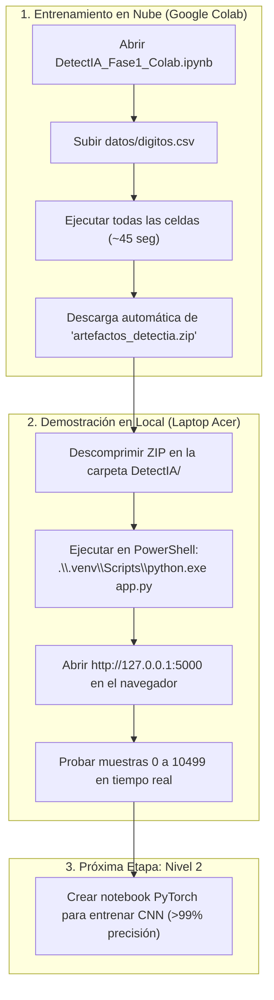

# DetectIA — Cuaderno de Contexto y Bitácora del Proyecto

> **Documento de referencia para el equipo de desarrollo.**  
> Resume la visión del proyecto, el diagnóstico del hardware, la estrategia de Machine Learning, el entorno preparado y el flujo de trabajo entre la nube y la máquina local.

---

## 1. Visión General del Proyecto DetectIA

**DetectIA** es un sistema de Inteligencia Artificial enfocado en **Visión por Computadora y Reconocimiento de Patrones**. Su objetivo es clasificar dígitos manuscritos del **0 al 9** a partir de imágenes en escala de grises de **$28 \times 28$ píxeles** (784 variables de entrada), utilizando como base las 42.000 muestras del dataset MNIST (`datos/digitos.csv`).

El proyecto fue concebido para una exhibición universitaria (aniversario institucional), con una fuerte orientación demostrativa e interactiva.

### 1.1. Estado Actual vs. Próximas Fases

* **Fase 1 (Línea Base / PoC - Actual)**:
  * Clasificador clásico de vectores de soporte (**SVM Lineal**) entrenado con `scikit-learn`.
  * Partición 75% entrenamiento (31.500 muestras) y 25% prueba (10.500 muestras).
  * Precisión alcanzada: **~96.98% (~97%)**.
  * Visualizaciones: histogramas de clases, renderizado $28 \times 28$ y matriz de confusión $10 \times 10$.
* **Fase 2 (Evolución a Red Neuronal Convolucional - PyTorch)**:
  * Desarrollo de una arquitectura **CNN** en PyTorch para superar el **99% de precisión**.
  * Incorporación de *Data Augmentation* (rotación, traslación, escalado) para tolerar trazos deformes o descentrados hechos a mano alzada.
* **Fase 3 (Aplicación Web Progresiva - PWA Móvil Táctil)**:
  * Lienzo interactivo táctil (HTML5 Canvas) optimizado para dedos o lápiz óptico.
  * Algoritmo de preprocesamiento en JavaScript en el navegador: cálculo de *bounding box*, escalado a $20 \times 20$ y centrado por **centro de masa** dentro de la cuadrícula de $28 \times 28$ (replicando la norma MNIST de Yann LeCun).
  * Inferencia en el cliente **100% offline** (modo avión) mediante Service Worker y modelo exportado en ONNX Web / JSON.
  * **Sin Base de Datos**: Arquitectura puramente matemática y *stateless* ($y = f(X)$).

---

## 2. Diagnóstico del Equipo y Criterio de Cuidado de Hardware

### 2.1. Ficha Técnica de la Laptop del Desarrollador
* **Equipo**: Acer Aspire A315-24P (`LAPTOP-T9ENK3TR`).
* **Procesador (CPU)**: AMD Ryzen 5 7520U (4 núcleos físicos / 8 lógicos, base 2.80 GHz, boost 3.73 GHz).
* **Memoria RAM**: 8.00 GB LPDDR5 5500 MT/s (**soldada en placa, no ampliable**).
* **Almacenamiento**: SSD NVMe 256 GB (~63.8 GB de espacio libre disponible).
* **Gráficos (GPU)**: AMD Radeon Graphics integrada (512 MB VRAM dedicada compartida con la RAM).
* **Sistema Operativo**: Windows 11 Home Single Language (64 bits).

### 2.2. Decisión de Arquitectura Térmica
Entrenar modelos de Machine Learning sobre 31.500 vectores de 784 dimensiones en una CPU de bajo consumo sin GPU dedicada genera una utilización sostenida al 100% que dispara las frecuencias Turbo (`3.73 GHz`) y el calor de los ventiladores.

* **Estrategia adoptada**:
  * **Entrenamiento pesado en la nube (Google Colab)**: Cero calentamiento, cero desgaste de batería, aprovechando la infraestructura de servidores de Google (y GPU NVIDIA T4 gratis para PyTorch en la Fase 2).
  * **Inferencia y visualización en local (Laptop)**: Ejecución liviana mediante un servidor local Flask (`app.py`), que responde en menos de 2 milisegundos con un consumo de CPU inferior al 1%.

---

## 3. Estrategia de Precisión en Machine Learning

Para maximizar el porcentaje de aciertos del proyecto, se definieron 4 niveles evolutivos:

| Nivel | Arquitectura / Técnica | Precisión Típica | Rol en el Proyecto |
| :---: | :--- | :---: | :--- |
| **Línea Base** | SVM Lineal (`SVC(kernel='linear')`) sobre píxeles crudos | ~96.98% | Modelo de partida para documentar y comparar. |
| **Nivel 1** | SVM con Kernel RBF + Normalización $[0.0, 1.0]$ | ~98.4% | Mejora clásica sin salir de Scikit-Learn. |
| **Nivel 2** | **Red Neuronal Convolucional (CNN) en PyTorch** | **~99.2% – 99.4%** | **Recomendación del docente.** Aprende patrones espaciales 2D (curvas, bordes). |
| **Nivel 3** | CNN + Data Augmentation + BatchNorm + LR Scheduler | **~99.5% – 99.7%** | Indispensable para que los trazos dibujados con el dedo en pantalla táctil no fallen. |
| **Nivel 4** | Ensamble (Comité de 5 a 10 CNNs con Soft Voting) | **>99.7%** | Técnica de competición de Kaggle para récords absolutos. |

---

## 4. Estado del Entorno de Desarrollo Local

El repositorio cuenta con la siguiente configuración preparada:

### 4.1. Archivos Clave del Repositorio
* **`.venv/`**: Entorno virtual de Python aislado para no contaminar el sistema global.
* **`requirements.txt`**: Librerías base instaladas (`numpy`, `pandas`, `scikit-learn==1.9.1`, `matplotlib`, `joblib`, `flask`).
* **`.gitignore`**: Configurado para excluir `.venv/`, cachés `__pycache__` y archivos binarios pesados (`.joblib`, `.npz`, `.onnx`).
* **`datos/digitos.csv`**: Dataset con 42.000 filas y 785 columnas (1 etiqueta + 784 píxeles).
* **`desarrollo/analisis.md`**: Requerimientos funcionales (RF-01 a RF-10) y no funcionales (RNF-01 a RNF-06).
* **`desarrollo/diseno.md`**: Arquitectura del sistema, justificación sin BD y diagrama de flujo.

### 4.2. Mejoras Implementadas en los Scripts
1. **Semilla Fija (`random_state=42`)**:  
   Garantiza que la división de datos sea 100% reproducible tanto en local como en Colab, evaluando siempre sobre las mismas 10.500 muestras de prueba para que la comparación con PyTorch sea justa y científica.
2. **Tolerancia de rutas**:  
   El código busca automáticamente tanto `datos/digitos.csv` como `DATOS/digitos.csv` para evitar errores en sistemas Linux/Mac sensibles a mayúsculas.
3. **Persistencia en formato Joblib / NPZ**:  
   El modelo entrenado se almacena en `modelo_svm.joblib` y el conjunto de prueba en `datos_test.npz`, evitando tener que reentrenar cada vez que se requiera hacer inferencias.

---

## 5. Herramientas Desarrolladas en esta Sesión

### 5.1. Cuaderno para Google Colab (`DetectIA_Fase1_Colab.ipynb`)
Permite entrenar el modelo SVM en la nube en ~45 segundos:
* **Celda 1**: Configura versiones compatibles de librerías (`scikit-learn 1.9.1`).
* **Celda 2**: Carga e inspecciona `digitos.csv`.
* **Celda 3**: Grafica el histograma de clases y una rejilla con 16 dígitos de muestra.
* **Celda 4**: Realiza la partición estratificada con `random_state=42`.
* **Celda 5**: Entrena el clasificador SVM con `cache_size=1000`.
* **Celda 6**: Evalúa métricas globales (Accuracy ~96.98%) y genera la Matriz de Confusión $10 \times 10$.
* **Celda 7**: Ejecuta la prueba individual sobre la muestra #1100.
* **Celda 8**: Empaqueta los artefactos en `artefactos_detectia.zip` y dispara la descarga automática a la laptop.

### 5.2. Explorador Web Local (`app.py` + `templates/index.html`)
Servidor web interactivo desarrollado con Flask para demostrar el modelo ante docentes o evaluadores:
* Permite ingresar manualmente **cualquier índice entre el `0` y el `10499`**.
* Botón **"🎲 Muestra Aleatoria"** para pruebas al azar.
* Botón **"⚠️ Siguiente Error del Modelo"** para inspeccionar casos difíciles donde el SVM se confunde (ideal para sustentar por qué se necesita la CNN en la siguiente fase).
* Renderizado gráfico de la matriz $28 \times 28$ con opción de cuadrícula visible e inversión de color.
* Panel comparativo: **Valor Real vs. Predicción del Modelo** con indicador de acierto o error.
* Barras de puntaje de decisión relativas por dígito y medición de latencia en milisegundos.

---

## 6. Flujo de Trabajo Operativo

---

*Fecha de registro: 18 de noviembre de 2026.*  
*Repositorio: `DetectIA`.*
