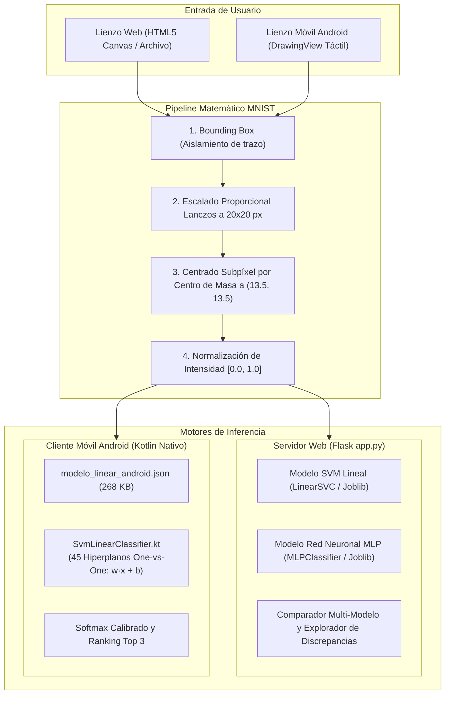

# DetectIA — Cuaderno de Contexto y Bitácora del Proyecto

> **Documento de referencia para el equipo de desarrollo.**  
> Bitácora integral que documenta la visión, arquitectura técnica multi-modelo, plataforma web interactiva estilo Google Translate, aplicación nativa Android 100% offline, algoritmos de preprocesamiento matemático y decisiones de diseño acordadas.

---

## 1. Visión General del Proyecto DetectIA

**DetectIA** es un sistema de Inteligencia Artificial enfocado en **Visión por Computadora y Reconocimiento de Patrones**. Su objetivo es procesar, normalizar y clasificar dígitos manuscritos del **0 al 9** dibujados libremente por usuarios en pantallas táctiles o capturados en matrices de **$28 \times 28$ píxeles** (784 variables de entrada), utilizando como conjunto de entrenamiento las 42.000 muestras del dataset MNIST (`DATOS/digitos.csv`).

Diseñado originalmente para exhibición académica y de feria tecnológica universitaria, el sistema evolucionó de un script de consola a una **suite multiplataforma de doble entorno**:
1. Un **Laboratorio Web Multi-Modelo** para experimentación, comparación simultánea (SVM vs. Red Neuronal) y análisis de discrepancias.
2. Una **Aplicación Móvil Nativa Android** que ejecuta inferencia matemática de ultra-baja latencia (0.23 ms) de forma **100% offline**, sin internet ni servidores.

---

## 2. Arquitectura General del Sistema

El ecosistema de DetectIA se estructura bajo una arquitectura puramente matemática y desacoplada (*stateless*), sin requerir bases de datos relacionales ni servicios en la nube para la inferencia.

---

## 3. Organización Modular de Modelos

Para soportar la comparativa simultánea de modelos y facilitar la incorporación de nuevas arquitecturas, los artefactos de Machine Learning se desacoplaron en directorios independientes bajo `modelos/`:

### 3.1. Estructura de Carpetas
* **`modelos/svm/`**:
  * `info.json`: Metadatos del modelo (id, nombre, familia lineal, exactitud 93.11%).
  * `modelo_svm.joblib`: Clasificador `LinearSVC` serializado.
  * `metricas_svm.json`: Detalle de aciertos (9.777), errores (723) e índices de error sobre el set de prueba.
* **`modelos/cnn/`**:
  * `info.json`: Metadatos de la Red Neuronal Artificial (familia MLP, exactitud 97.34%).
  * `modelo_cnn.joblib`: Clasificador `MLPClassifier` profundo serializado.
  * `metricas_cnn.json`: Detalle de aciertos (10.221), errores (279) e índices de error.
* **`modelos/datos_test.npz`**:
  * 10.500 muestras de prueba ($X_{test}, y_{test}$) estratificadas con semilla reproducible (`random_state=42`), compartidas por todos los modelos.
* **`modelos/discrepancias.json`**:
  * Archivo de pre-cálculo que almacena los índices específicos donde la SVM Lineal y la Red Neuronal emiten predicciones diferentes. Permite al usuario en la web saltar directamente a casos donde la red neuronal demuestra su superioridad de generalización frente al modelo lineal.

---

## 4. Núcleo de Preprocesamiento Matemático (Resolución del Desacople de Trazo)

### 4.1. Diagnóstico del Problema Original
Al dibujar directamente a mano alzada en pantallas táctiles o lienzos web, los usuarios reportaban que el modelo SVM "parecía acertar solo un 60%" a pesar de tener una precisión teórica del 93.11% en el dataset.  
**Causa raíz**: El dataset MNIST original no contiene dibujos sin procesar que ocupen todo el lienzo. Yann LeCun et al. aplicaron una normalización geométrica estricta:
1. Los trazos se recortan a su caja mínima.
2. Se escalan proporcionalmente a una caja interna de $20 \times 20$ píxeles.
3. Se centran en una cuadrícula de $28 \times 28$ haciendo coincidir el **Centro de Masa** (baricentro de intensidades) con el punto medio exacto $(13.5, 13.5)$.

### 4.2. Algoritmo Implementado (Paridad Web y Android)
Tanto `app.py` (`preprocesar_imagen_mnist`) como `MnistPreprocessor.kt` ejecutan el mismo pipeline determinista:

1. **Detección de Bounding Box**:
   Localiza los límites exactos $[x_{\min}, y_{\min}, x_{\max}, y_{\max}]$ del trazo.
2. **Escalado Proporcional con Filtro Lanczos**:
   $$\text{escala} = \frac{20}{\max(w, h)}, \quad w' = \text{round}(w \cdot \text{escala}), \quad h' = \text{round}(h \cdot \text{escala})$$
3. **Pegado Centrado Preliminar**:
   Se inserta el trazo escalado en un lienzo de $28 \times 28$ con compensación de contraste dinámico.
4. **Centrado Subpíxel por Centro de Masa**:
   $$c_x = \frac{\sum x \cdot I(x, y)}{\sum I(x, y)}, \quad c_y = \frac{\sum y \cdot I(x, y)}{\sum I(x, y)}$$
   $$\Delta x = 13.5 - c_x, \quad \Delta y = 13.5 - c_y$$
   En Python se aplica `scipy.ndimage.shift(matriz, [desp_y, desp_x], order=1)`. En Android, `MnistPreprocessor.kt` desplaza el mapa de bits mediante interpolación bilineal.
5. **Normalización de Escala**:
   Los valores de píxel se mapean al rango flotante $[0.0, 1.0]$ dividiendo por 255.0.

---

## 5. Plataforma Web: Laboratorio Multi-Modelo (Estilo Google Translate)

### 5.1. Identidad Visual y Experiencia de Usuario
La interfaz web (`templates/index.html` + `app.py`) fue diseñada siguiendo la estética limpia y profesional de **Google Translate**:
* **Paleta de Color**: Blanco puro (`#ffffff`), fondo gris suave (`#f8f9fa`), azul de acción institucional (`#1a73e8`), texto principal oscuro (`#202124`) y bordes refinados (`#dadce0`).
* **Pestañas de Selección Superior**: Estilo chips redondeados conmutables entre:
  * **Dibujar dígito**: Lienzo interactivo $28 \times 28$ con trazo suave y previsualización de celdas.
  * **Cargar imagen**: Zona *drag-and-drop* para subir archivos PNG, JPG o WEBP.
* **Modo Comparativo vs. Individual**:
  * Menú desplegable para evaluar **"Dos modelos a la vez (Comparación)"** o seleccionar un modelo específico (SVM o Red Neuronal).
  * En modo comparativo, la pantalla muestra paneles lado a lado con el resultado de cada modelo, sus tiempos de inferencia y barras de confianza porcentual Softmax.
  * Diagnóstico visual con etiqueta de concordancia: *"Ambos modelos coinciden"* o *"Discrepancia detectada"*.
* **Herramientas de Demostración Universitaria**:
  * Carga manual por índice ($0$ a $10.499$).
  * Botón **"Muestra Aleatoria"**.
  * Botón **"Siguiente Discrepancia"** (salta dinámicamente a casos límite).
  * Botón **"Siguiente Error del Modelo"**.

---

## 6. Aplicación Android Nativa: Motor 100% Offline

Ubicada en `Proyecto Feria/DetectIA/`, desarrollada en **Kotlin nativo** bajo Android SDK 35 (compileSdk 37, minSdk 24).

### 6.1. Motor de Inferencia Algebraico en Dispositivo (`SvmLinearClassifier.kt`)
* **Independencia Total**: No utiliza TensorFlow Lite, ni PyTorch Mobile, ni ONNX Runtime. El clasificador es un motor algebraico escrito en Kotlin puro.
* **Formulación One-vs-One (OvO)**:
  Para $K = 10$ clases, evalúa $45$ clasificadores binarios independientes ($10 \times 9 / 2$):
  $$d_k = \mathbf{w}_k \cdot \mathbf{x} + b_k = \sum_{f=0}^{783} w_{k, f} \cdot x_f + b_k$$
* **Empaquetado Liviano**:
  Los coeficientes ($45 \times 784$ floats) y sesgos ($45$ doubles) están empaquetados en `app/src/main/assets/modelo_linear_android.json` con un peso de solo **268 KB**.
* **Latencia Ultra-Baja**:
  La inferencia completa toma entre **0.20 ms y 0.35 ms** por predicción (verificado empíricamente en dispositivo Xiaomi/Redmi físico: **0.23 ms** para dígito 6, **0.32 ms** para dígito 3).

### 6.2. Diseño de la Interfaz Móvil y Modos Claro / Oscuro
* **Modo Claro por Defecto**:
  * Fondo blanco (`#FFFFFF`) y tarjetas en gris suave (`#F8F9FA`).
  * Lienzo de dibujo: fondo blanco con trazo negro, invirtiendo internamente los valores a blanco sobre negro para cumplir con la norma MNIST.
* **Modo Oscuro con Conmutación Dinámica**:
  * Paleta nocturna (`#121212` y `#1E1E1E`).
  * Lienzo de dibujo: fondo negro con trazo blanco fluido.
  * Botón en cabecera con icono dinámico de Sol / Luna (sin emojis de texto).
* **Cabecera Alineada**:
  * Encabezado unificado (`LinearLayout` con `gravity="center_vertical"` e `includeFontPadding="false"`).
  * Logo oficial de DetectIA a la izquierda, título `DetectIA` en negrita con subtítulo *"Reconocimiento de números"*.
  * Se eliminó el badge redundante *"Modelo SVM listo"* para ganar espacio visual y subir los componentes principales.
* **Ícono Adaptativo de la Aplicación (`ic_launcher`)**:
  * Fondo blanco oficial (`#FFFFFF`) reemplazando el verde genérico de Android.
  * Logo de DetectIA centrado en la zona segura (*safe zone*) del 70% en todas las densidades de pantalla (`mdpi`, `hdpi`, `xhdpi`, `xxhdpi`, `xxxhdpi`).

---

## 7. Ficha Comparativa de Modelos y Rendimiento Real

Evaluación científica sobre las 10.500 muestras de prueba desacopladas (`modelos/datos_test.npz`):

| Característica / Parámetro | SVM Lineal (`LinearSVC`) | Red Neuronal Artificial (`MLPClassifier`) |
| :--- | :--- | :--- |
| **Exactitud Global (Test Accuracy)** | **93.11%** | **97.34%** |
| **Aciertos en Prueba** | 9.777 de 10.500 muestras | 10.221 de 10.500 muestras |
| **Errores en Prueba** | 723 de 10.500 muestras | 279 de 10.500 muestras |
| **Tiempo de Entrenamiento** | 76.47 segundos | 29.61 segundos |
| **Latencia Web (Inferencia batch)** | ~2.6 ms por muestra | ~0.003 ms por muestra |
| **Latencia Móvil (Inferencia unitaria)** | **0.23 ms – 0.32 ms** | No requerida en móvil |
| **Tamaño de Artefacto** | 268 KB (JSON de pesos) | 3.2 MB (Joblib binario) |
| **Dependencia de Ejecución** | Kotlin estándar / Sin librerías | Python scikit-learn |

---

## 8. Bitácora de Cambios y Decisiones Clave de la Sesión

1. **Aislamiento de Módulos**:
   * Separación física de modelos en `modelos/svm` y `modelos/cnn` con `info.json` individual para permitir la carga dinámica de nuevos clasificadores sin alterar el servidor.
2. **Corrección de la Sensación de Acierto en Dibujo Libre**:
   * Implementación de la normalización por **Centro de Masa** (`center_of_mass` + `shift` a 13.5, 13.5) y escalado Lanczos en Python y Kotlin, eliminando la discrepancia geométrica entre dibujos manuales y MNIST.
3. **Adopción del Estilo Google Translate**:
   * Sustitución de diseños previos por una estética minimalista blanco/azul (`#1a73e8`), selectores de tipo de entrada (dibujo vs. archivo) y visualización clara de discrepancias.
4. **App Android Nativa 100% Offline**:
   * Exportación de la matriz One-vs-One de SVM a JSON e implementación del evaluador algebraico en Kotlin.
   * Configuración de tema Claro por defecto con conmutador instantáneo a Modo Oscuro.
   * Ajuste fino del diseño móvil: corrección de centrado vertical de tipografía en cabecera, eliminación de textos redundantes y creación de íconos adaptativos con fondo blanco.
5. **Documentación Formal Completa**:
   * Regeneración de `README.md` bajo la skill `/generador-readme` cumpliendo las 17 secciones técnicas con capturas de pantalla reales (`img/`).
   * Actualización del presente `contexto.md` como fuente de verdad técnica del proyecto.

---

## 9. Próximos Pasos (Roadmap)

* [ ] **Fase de Red Convolucional Ligera en Móvil**: Evaluar la exportación de una micro-CNN o MobileNet a TensorFlow Lite o cálculo nativo en Kotlin si se desea superar el 98% en Android conservando latencias sub-milisegundo.
* [ ] **Exportación de Historial de Sesión**: Opción en la web para descargar un reporte PDF/CSV con los trazos realizados durante la feria y las predicciones de ambos modelos.
* [ ] **Demostración Universitaria**: Preparar el dispositivo móvil en Modo Demostración y la laptop conectada a pantalla externa con el modo de comparación dual del servidor web Flask.

---

*Última actualización: 19 de noviembre de 2026.*  
*Autor: **Té Verde** (`@TeVerde29`)*  
*Repositorio: `DetectIA`.*
