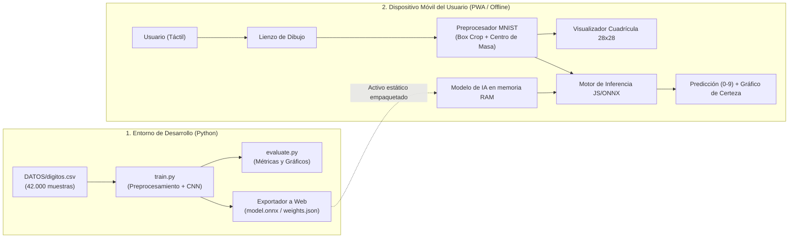
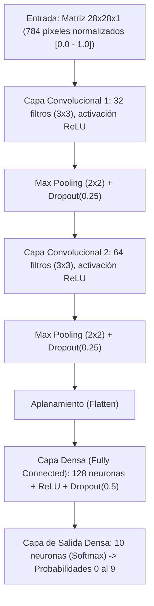
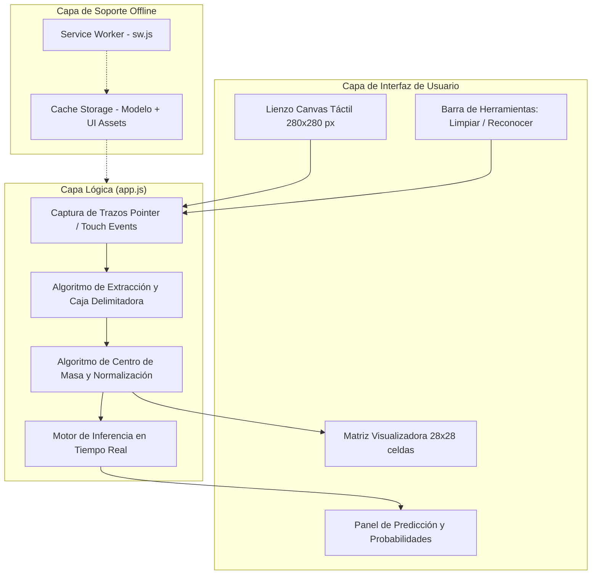
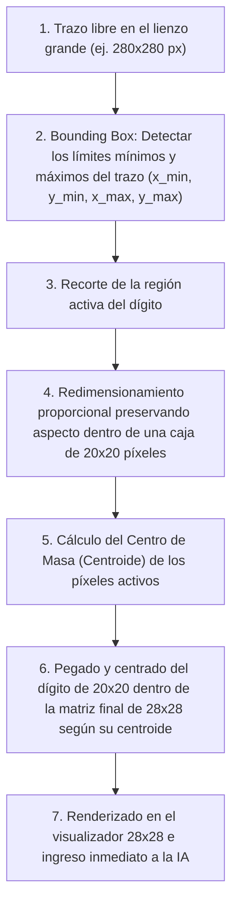
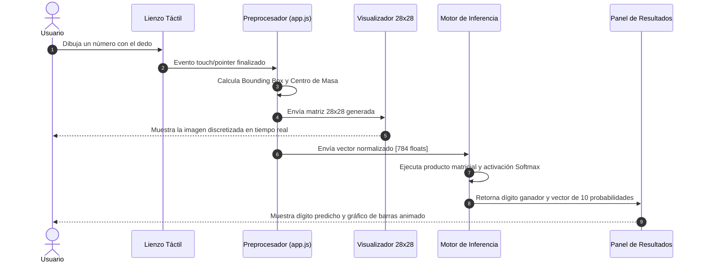

# Documento de Diseño y Arquitectura de Software - DetectIA

## 1. Visión General de la Arquitectura

**DetectIA** implementa una arquitectura desacoplada en dos subsistemas principales:

1. **Subsistema de Inteligencia Artificial y Entrenamiento (Python / Offline Pipeline)**: Se ejecuta una única vez en entorno de desarrollo. Carga el dataset [`DATOS/digitos.csv`](file:///c:/Users/hikih/Documents/Repositorios/DetectIA/DATOS/digitos.csv), entrena la red neuronal, valida métricas y compila el modelo a un formato portable optimizado para la web.
2. **Subsistema de Presentación e Inferencia en Cliente (PWA Móvil / Runtime)**: Aplicación web progresiva basada en HTML5, CSS y Vanilla JS. Se ejecuta directamente en el navegador del teléfono móvil de forma 100% autónoma y offline.

---

## 2. Justificación Técnica: ¿Es Necesaria una Base de Datos?

> [!IMPORTANT]
> **Dictamen Técnico: NO es necesaria una Base de Datos.**

A continuación se detalla la justificación técnica y arquitectónica para fundamentar esta decisión ante el jurado o los docentes:

| Criterio | Justificación Técnica |
| :--- | :--- |
| **Naturaleza Stateless (Sin Estado) de la Inferencia** | El reconocimiento de patrones mediante redes neuronales es una función matemática pura: $y = f(X)$, donde $X$ son los 784 píxeles del dibujo y $y$ es la probabilidad de cada dígito. Una vez calculada la salida, el sistema no requiere guardar el dibujo para operar el siguiente. |
| **Persistencia del Conocimiento en el Modelo** | Todo el aprendizaje extraído de las 42.000 imágenes ya queda condensado y "congelado" en la matriz de pesos y sesgos sinápticos del modelo exportado. El archivo del modelo actúa como la "memoria estática" del sistema. |
| **Requisito Crítico de Autonomía 100% Offline** | Incorporar un gestor de base de datos cliente-servidor (como PostgreSQL o MySQL) obligaría al teléfono a tener conexión a una red y a un servidor encendido durante el evento, aumentando puntos de fallo en vivo. |
| **Cero Recolección y Privacidad de Datos** | La aplicación no maneja cuentas de usuario, contraseñas, roles ni transacciones que ameriten tablas relacionales. |
| **Almacenamiento Local Opcional (Sin BD)** | Si en el futuro se deseara guardar los últimos 5 dibujos del usuario como historial visual, el estándar web provee `localStorage` o `IndexedDB` nativo del navegador sin necesidad de levantar ningún motor de bases de datos. |

---

## 3. Arquitectura del Módulo de Machine Learning (Python)

El pipeline de Python se encarga del modelado científico de los datos.

### 3.1. Arquitectura de la Red Neuronal
Para superar el 97% alcanzado por el SVM lineal del documento y tolerar los trazos imperfectos del dedo en pantalla, se implementa una arquitectura neuronal optimizada:

### 3.2. Proceso de Exportación
El script de entrenamiento genera:
1. `model.onnx` o `model_weights.json`: Estructura compacta para ser interpretada por el motor de inferencia en JavaScript en el navegador del teléfono.
2. `metricas_entrenamiento.png`: Gráficos de precisión y pérdida por época junto con la matriz de confusión para el informe del proyecto.

---

## 4. Arquitectura del Módulo Cliente Móvil (PWA)

El cliente web sigue la estructura de diseño probada en proyectos como **UNUmbral**:

---

## 5. Algoritmo de Preprocesamiento en Cliente

Este componente es el secreto para que los números dibujados con el dedo sean reconocidos con exactitud:

---

## 6. Diagrama de Secuencia de la Interacción del Usuario

---

## 7. Estrategia de Empaquetado y Despliegue

1. **Despliegue Web / PWA (GitHub Pages)**:
   * Al ser archivos estáticos (`index.html`, `estilos.css`, `app.js`, `sw.js` y el modelo), se publica directamente en GitHub Pages con HTTPS gratuito.
   * Cuenta con soporte de instalación en Android / iOS (añadir a pantalla de inicio).
2. **Empaquetado Nativo Android (Opcional vía Capacitor)**:
   * Mediante `capacitor.config.json`, el proyecto puede compilarse directamente a un archivo `.apk` instalable en teléfonos Android usando Android Studio.
3. **Servidor Local de Demostración (Python Flask)**:
   * Se incluye un archivo `server.py` que permite ejecutar `python server.py` para levantar un servidor local en caso de que la cátedra solicite una demostración en vivo de arquitectura cliente-servidor.
